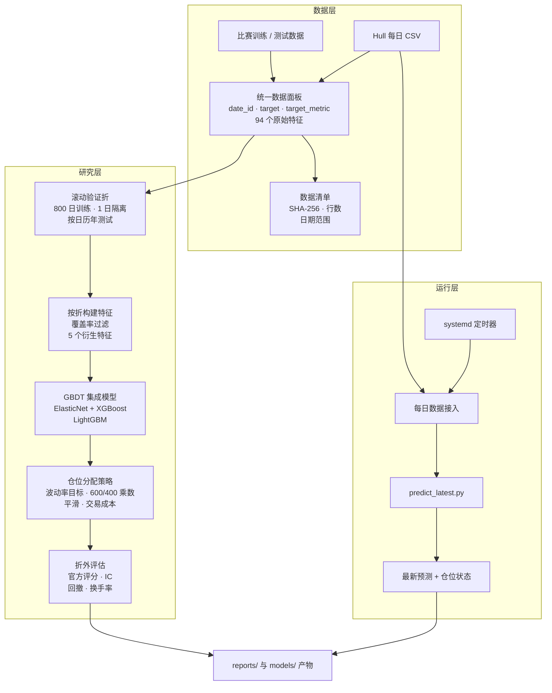
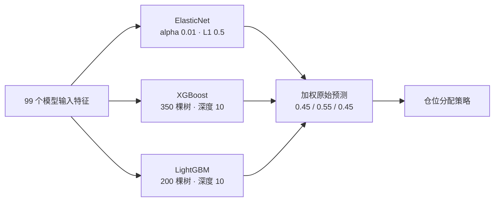

# Hull Tactical — 市场预测研究管线

面向 Hull Tactical Kaggle 竞赛的可复现研究管线：统一时点数据面板、统一官方评分、共享仓位分配层，以及带严格样本外验证的 GBDT 模型族。

**状态：** 研究基线 · Python 3.12 · 48 项测试 · 1,488 个折外（out-of-fold，OOF）交易日
**主指标：** 竞赛波动率调整夏普（volatility-adjusted Sharpe）
**模型：** ElasticNet + XGBoost + LightGBM
**数据频率：** 日频，每个交易日一行

---

## 1. 项目做什么

原始提交是一份 Kaggle notebook。本项目把它整理成可维护的研究系统：

- **统一数据面板**：比赛数据和每日实盘数据进入同一套字段契约；
- **统一滚动验证**：所有模型和实验共用同一套滚动前向验证（walk-forward）协议；
- **统一仓位分配层**：训练、回测和每日推理共用同一个仓位分配策略（allocation policy）；
- **隔离的 notebook 一致性路径**：历史复现不会污染生产特征路径；
- **可审计的实验体系**：覆盖基准、部署回放、归因、实盘窗口和特征诊断；
- **可重复产物**：数据哈希、运行清单、测试和固定配置。

这个仓库的目标不是宣称模型能战胜市场，而是让模型行为可以被测量、复现和审计。

---

## 2. 比赛背景：有效市场假说与预测问题

Hull Tactical 的 Kaggle 竞赛要求参赛者预测 **S&P 500 的日度超额收益**，并把预测转换为每个交易日的市场仓位。仓位范围是 `0` 到 `2`：`0` 表示全部持有现金，`1` 表示满仓，`2` 表示两倍杠杆。策略还必须控制风险，不能让波动率明显超过市场；官方约束是 **120% 的市场波动率**。

评分不是普通夏普，而是竞赛定制的一个变体：它惩罚两类行为：

- 策略波动率显著高于市场；
- 策略收益低于市场收益。

这使问题同时包含“预测收益”和“仓位/风险管理”两部分。官方说明将竞赛定位为对 **有效市场假说（Efficient Market Hypothesis，EMH）** 的检验。EMH 的核心主张是：价格已经反映了可获得的信息，因此持续战胜市场不可能。弱式有效市场假说认为历史价格无法提供稳定超额收益，半强式有效市场假说认为公开信息已经被定价，强式有效市场假说则进一步认为所有信息（包括非公开信息）都已经反映在价格中。

竞赛发起方给出的相反论点是：市场充满噪声、行为偏差和结构性摩擦，机器学习加上公开市场数据和专有信号，可能找到传统理论没有覆盖的可重复模式；但即使存在模式，也必须能承受交易成本、杠杆约束和实盘执行问题。竞赛还包含一段独立预测期，模型会在真实市场数据上运行，因此这不是纯学术回测。

官方竞赛说明：[Hull Tactical - Market Prediction](https://www.kaggle.com/competitions/hull-tactical-market-prediction/overview)。

本项目因此把问题当作一个**可证伪的预测与仓位管理问题**，而不是把排行榜分数直接当作 EMH 被推翻的证据。研究重点是：预测信号是否提供增量方向信息，仓位分配是否只是暴露层的贡献，以及这些结论能否通过时间顺序验证、成本压力、多重检验和独立窗口检查。

---

## 3. 架构



各层依赖是单向的：

```text
common/     数据、字段、特征、变换、切分、指标、仓位分配、回测、
            管线、数据接入、运行注册、验证
gdbt/       表格模型族和 notebook 一致性特征构建器
dl/         序列模型接口，暂未实现
```

`common` 不依赖 `gdbt`，`gdbt` 依赖 `common`。这样评估和仓位分配契约就不会绑死在某一个模型族上。

### 模型结构



权重沿用原始 notebook，总和为 1.45。一致性配置保留未归一化权重，以便复现提交；所有实验使用同一组固定权重。

---

## 4. 数据契约

数据面板每个交易日一行：

| 字段 | 含义 |
| --- | --- |
| `date_id` | 交易日整数键 |
| `date` | 日历日期 |
| `target` | 竞赛目标：`market_forward_excess_returns` |
| `target_metric` | 评估标签：`forward_returns - risk_free_rate` |
| `D* E* I* M* P* S* V*` | 94 个匿名市场特征 |
| `is_scored` | 测试行评分标记 |

比赛数据包含 9,048 个训练日。实盘数据是每日更新的超集，尾部存在待实现目标值；待实现行不会被填成 0，也不会被当作已实现标签。

特征契约详见 [`docs/feature_engineering.md`](docs/feature_engineering.md)。

---

## 5. 模型与仓位分配

训练窗口和模型参数由配置固定：

```text
max_train_rows       800
min_date_id          37
missing_threshold    0.5
vol_window           20
signal multiplier    600（低 V1）/ 400（高 V1）
signal clip          0 .. 2
vol scaling          1.2
smoothing            0.75 * 新仓位 + 0.25 * 上一期仓位
transaction cost     3e-5
```

对日期 `t`，模型只使用 `date_id < t` 且目标已实现的数据训练；预测写入后，才把 `t` 已实现的目标反馈给仓位状态：

```text
raw_pred     = 0.45 * enet + 0.55 * xgb + 0.45 * lgb
signal       = clip(raw_pred * multiplier, 0, 2)
allocation   = clip(signal / (vol * 1.2), 0, 2)
allocation   = (0.75 * allocation + 0.25 * previous) * (1 - 3e-5)
```

---

## 6. 防止过拟合的设计

这些是全项目统一执行的控制，不是对信号强度的宣称。


1. **只用滚动前向验证。** 六个日历年折（2015、2017、2019、2021、2023、2025），固定 800 日训练窗口和 1 日隔离间隔（purge gap）；不做随机训练/测试切分，不允许未来行进入训练。
2. **按折拟合预处理。** 缺失率过滤、中位数和标准化都只在训练窗口上拟合；测试行只使用已保存的统计量做变换。
3. **显式时间断言。** 训练行必须满足 `train_end < date_id`；归因 OOF 对每一行都做检查。仓位策略只有在预测写入后才看到当期已实现目标。
4. **隔离 notebook 一致性路径。** 提交 notebook 的历史行为由专用构建器复现；它的填充规则和训练期诊断特征不代表生产特征收益。
5. **强基准。** 所有模型结果都和买入持有、固定仓位、仅波动率、常数预测消融、折内预测置换对比。
6. **暴露匹配。** 在线模型除了和买入持有比较，还要和 `lag1`、扩展均值等因果暴露基准比较。
7. **不在测试窗口选参。** 信号乘数网格、市场状态阈值和检验族在读取赛后窗口之前冻结；锁定窗口不用于选模型或选参数。
8. **多重检验校正。** 在需要检验族的实验中，使用 HAC/Newey-West 推断、按折分层移动块自助法（moving-block bootstrap）、Holm 校正和 Benjamini–Hochberg 错误发现率（FDR）。
9. **成本和换手压力测试。** 同时报告官方评分、原始夏普、换手率、最大回撤和按换手率线性计费的压力结果。
10. **冻结证据。** OOF 文件是不可变证据；归因运行会复制文件并记录 SHA-256，哈希变化即失败，不允许静默覆盖。
11. **测试作为发布门槛。** 指标一致性、notebook 一致性、泄漏、管线、数据接入和研究辅助函数共覆盖 48 项测试。

这些控制能减少回测虚高的常见来源，但不会把弱信号变成强信号；下面的结果按实际观测报告。

---

## 7. 结果概览

### 六折滚动验证

1,488 个样本外交易日的折均值和连续拼接指标：

| 策略 | 官方评分（折均值） | 官方评分（拼接） | 原始夏普（折均值） | 原始夏普（拼接） | 累计收益（拼接） | 最大回撤（拼接） | 换手率 | 平均仓位 |
| --- | ---: | ---: | ---: | ---: | ---: | ---: | ---: | ---: |
| 买入持有 | **1.498** | **1.280** | 1.498 | 1.280 | 203.9% | -18.0% | 0.001 | 1.000 |
| 固定仓位 1.25 | 1.411 | 1.204 | 1.481 | 1.264 | 283.3% | -22.3% | 0.001 | 1.250 |
| 仅波动率 1.0x | 1.267 | 1.151 | 1.486 | 1.329 | 354.9% | -20.6% | 0.066 | 1.200 |
| GBDT 在线更新 | 1.253 | 1.271 | 1.435 | 1.277 | 191.7% | -20.1% | 0.514 | 0.652 |
| 每日重训 | 0.871 | 0.808 | 1.114 | 0.966 | 134.1% | -19.3% | 0.520 | 0.659 |
| GBDT 离线 | 0.833 | 0.419 | 0.992 | 0.629 | 109.5% | -31.8% | 0.304 | 0.495 |

官方评分不是普通夏普：它包含竞赛的波动率惩罚和收益惩罚；原始夏普是未经过这两项惩罚的日收益年化夏普。累计收益和最大回撤按拼接后的 OOF 路径计算，不是一条连续账户曲线；换手率是平均每日仓位变化，不是交易成本本身。完整定义见 [`docs/deployment_eval.md`](docs/deployment_eval.md)。

在这个样本里，GBDT 没有建立稳定的增量优势；严格执行部署路径的每日重训也弱于固定构建器/在线更新的路径。

### 实盘评估期与最终排行榜

竞赛官方实盘评估期是 **2025-12-16 至 2026-06-25**，共 131 个交易日。仓库另外保留到 2026-07-06 的 **137 日研究扩展窗口**；该扩展不属于官方竞赛窗口。

| 证据层 | 分数 | 标签 |
| --- | ---: | --- |
| 官方实盘评估期，仓库每日代理 | 2.148 | 重建 `fwd = target_metric, rf = 0` |
| 137 日研究扩展 | 2.192 | 本地代理，不是排行榜 |
| 本地逐行执行 `final_submission.ipynb`，131 日 | 2.25 | 本地 notebook 回放 |
| Kaggle 最终私有排行榜 | **3.263** | 被选中的 notebook 提交 |

131 日官方评估期的风险与交易指标（本地测试，不是 Kaggle 私有排行榜）：

| 协议 | 代理评分 | 原始夏普 | 累计收益 | 最大回撤 | 换手率 | 平均仓位 |
| --- | ---: | ---: | ---: | ---: | ---: | ---: |
| 每日重训 | 2.148 | 2.148 | 11.50% | -4.01% | 0.524 | 0.709 |
| 固定构建器 + 滚动模型 | 2.152 | 2.152 | 11.52% | -4.01% | 0.529 | 0.713 |
| 离线 | 2.090 | 2.090 | 11.24% | -3.67% | 0.369 | 0.475 |
| 仅波动率 1.0x | 0.843 | 0.910 | 4.81% | -4.52% | 0.094 | 0.662 |
| 买入持有 | 0.860 | 0.860 | 6.36% | -9.66% | 0.008 | 1.000 |
| 固定仓位 1.25 | 0.803 | 0.843 | 7.85% | -11.97% | 0.010 | 1.250 |

`3.263` 是官方私有排行榜分数；本地 notebook 回放和仓库代理不是同一个提交路径，不能直接互换。Kaggle 私有排行榜不提供与本地代理同口径的换手率和回撤，不能用上面的本地指标替代排行榜结果。排行榜对齐过程记录在 [`docs/experiments.md`](docs/experiments.md) 和 Phase 8 报告中。

### 特征诊断

Phase 8 对 99 个模型输入特征计算时间序列秩相关信息系数（RankIC）：

- 5 个特征通过 Benjamini–Hochberg 校正，q <= 0.05：`E19`、`M1`、`V7`、`V9`、`V13`。
- `V10` 在模型输入层是边界情况（q = 0.052），在原始特征层显著（q = 0.005）。
- `D1` 与 `D2` 完全重复。
- 14 对特征的绝对 Spearman 相关系数 >= 0.90。
- 这些诊断没有改变模型、特征集合或策略。

详见 [`docs/feature_rankic_analysis.md`](docs/feature_rankic_analysis.md)。

---

## 8. 八个实验阶段

完整报告见 [`docs/experiments.md`](docs/experiments.md)。

| # | 实验 | 核心问题 |
| --- | --- | --- |
| 1 | notebook 回放与六折验证 | 管线能否复现 notebook，OOF 基线是什么？ |
| 2 | 基准与消融 | 模型是否优于买入持有、固定仓位、仅波动率和常数预测？ |
| 3 | 时间序列验证与暴露匹配 | 结果能否区别于时间置换和暴露匹配的零假设？ |
| 4 | 部署一致性的每日重训 | 生产协议能否复现在线结果？ |
| 5 | 特征构建与重训归因 | 差距来自特征重建还是每日模型更新？ |
| 6 | 官方窗口归因与排行榜对齐 | 实盘分数中信号、乘数和平滑各占多少？ |
| 7 | 信号稳健性与锁定窗口 | 信号能否经受市场状态、集中度、HAC 和 Holm？ |
| 8 | 特征级 RankIC | 哪些特征有持续秩相关，冗余程度如何？ |

---

## 9. 目录结构

```text
common/      共享数据、字段、特征、指标、仓位分配、回测、管线、
             数据接入、注册、验证
gdbt/        ElasticNet + XGBoost + LightGBM 模型族
dl/          序列模型接口，暂未实现
configs/     基础配置、CV、验证、Phase 4/5/6/8 配置
scripts/     回放、CV、每日接入、每日任务和研究入口
tests/       指标一致性、notebook 一致性、泄漏、接入和研究测试
data/        比赛训练/测试数据、日期映射和数据清单
deploy/      systemd 服务/定时器和服务器安装说明
docs/        架构、实验、特征工程和各阶段报告
reports/     生成的实验产物（gitignored）
models/      生成的运行产物和模型文件（gitignored）
```

跟踪数据和生成产物刻意分离。`reports/` 和 `models/` 是可复现输出，不进入 Git。

---

## 10. 快速开始

```bash
conda create -n hull python=3.12 -y
conda activate hull
pip install -e ".[dev]"

# 1. notebook 回放（样本内一致性检查）
python scripts/run_replay.py --no-wandb

# 2. 六折滚动验证（样本外）
python scripts/run_cv.py --offline --no-wandb

# 3. 基准与消融
python scripts/run_experiments.py --shuffles 1000

# 4. 全量测试
pytest -q
```

特征诊断需要先有 OOF；脚本会按顺序使用 `--oof`、配置路径、最新的离线 CV 产物，并提供明确报错：

```bash
python scripts/run_phase8_feature_rankic.py \
  --config configs/gdbt/phase8.yaml
```

---

## 11. 复现规则

- `pyproject.toml` 是唯一依赖源；不再使用 `requirements.txt`。
- 每次运行在 `models/<run_id>/` 下写入运行清单和模型产物。
- `data/manifest.json` 记录数据哈希、行数和日期范围。
- 归因分析前会复制 OOF 并记录哈希；哈希变化时停止，不允许静默覆盖。
- `docs/reference/hull-competition-sharpe.ipynb` 用于对保存的仓位执行官方评分，以验证指标实现。
- 仓库不会自动执行 `kaggle submit`，提交始终由人工完成。

---

## 12. 范围与限制

- OOF 是六段不连续日历年的 1,488 个交易日，不是一条连续账户曲线。
- 私有排行榜是一条已实现的实盘路径，不是第二次独立回测。
- 本地 `2.192` / `2.25` 是重建代理；Kaggle `3.263` 是被选中提交的官方私有分数。
- 模型尚未证明在扣除成本后能稳定跑赢简单基准；在 GBDT 结论明确前，不启动深度学习。

---

## 13. 文档

| 文档 | 内容 |
| --- | --- |
| [`docs/experiments.md`](docs/experiments.md) | 八个实验阶段和结果 |
| [`docs/feature_engineering.md`](docs/feature_engineering.md) | 特征契约、衍生特征和选择依据 |
| [`docs/final_research_report.md`](docs/final_research_report.md) | 综合研究报告和限制 |
| [`docs/feature_rankic_analysis.md`](docs/feature_rankic_analysis.md) | Phase 8 特征级 RankIC 报告 |
| [`docs/repro_gdbt.md`](docs/repro_gdbt.md) | 环境、命令和产物清单 |
| [`docs/data_manifest.md`](docs/data_manifest.md) | 数据来源和哈希 |
| [`docs/research_decisions.md`](docs/research_decisions.md) | D1–D17 决策记录 |

## 14. 部署

每日任务：

```bash
python scripts/ingest_daily.py
python scripts/daily_job.py
```

`deploy/` 包含 systemd 服务和定时器。任务会校验源数据字段与日期重叠，原子替换实盘面板，预测最新已实现行，并保留上一期仓位用于平滑。服务器安装步骤见 [`deploy/README.md`](deploy/README.md)。
