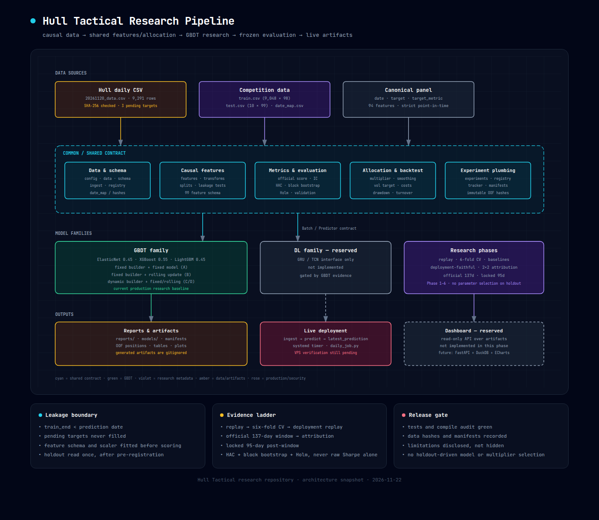
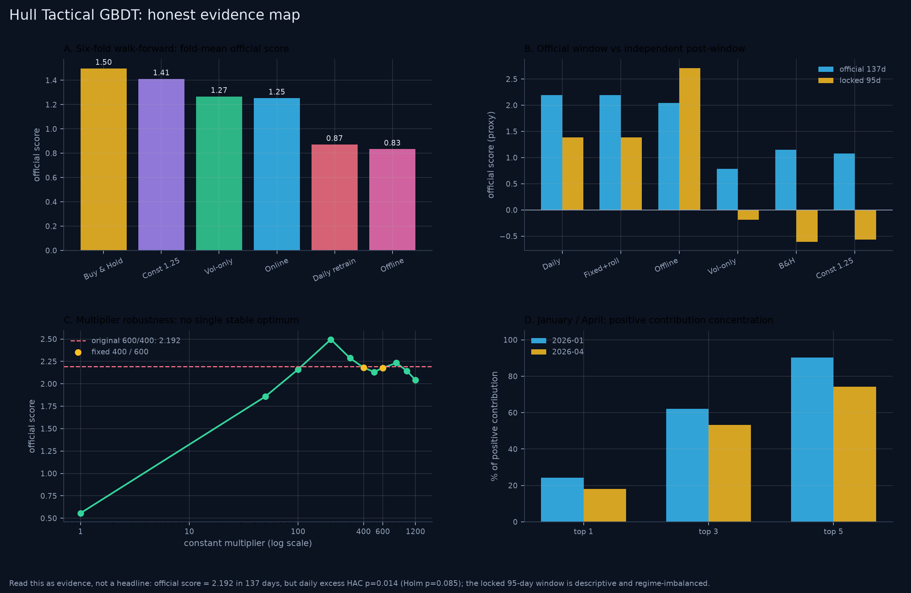

# Hull Tactical research pipeline

Shared data/metric/allocation layer plus two model families:

```
common/       shared config/data/schema/features/transforms/splits/metrics/
              allocation/backtest/pipeline/ingest/registry/validation/evaluation
gdbt/         tabular model family (ElasticNet + XGBoost + LightGBM)
dl/           sequence model family (interface reserved; not implemented)
configs/      base config + gdbt CV/phase configs + validation config
scripts/      thin entry points for replay, CV, live ingest, research phases
deploy/       systemd service/timer and server installation notes
docs/         reproduction/validation/deployment/live-window reports
docs/assets/  architecture.html, architecture.png, core_results.png/svg
docs/reference/  official competition scoring notebook
tests/        metric parity, notebook parity, leakage, ingest, research, Phase 6 and Phase 8 tests
data/manifest.json  data hashes, row counts, date ranges and provenance
```

The repository has completed the GBDT research sequence:

- notebook replay and six-fold walk-forward CV;
- baseline/ablation and temporal-validation studies;
- deployment-faithful daily-retrain and E14 stress checks;
- Phase 4 fixed/dynamic feature-builder and retraining attribution;
- Phase 5 official 137-day competition-window attribution;
- Phase 6 signal-by-regime, multiplier, concentration and independent-window
  robustness checks;
- Phase 7 final report, decision history and data/version audit;
- Phase 8 feature-level RankIC diagnosis (read-only; no feature selection).

Deep Learning is intentionally not implemented yet; a GBDT incremental-value
gate precedes it.

## Start here

- **Final report:** [`docs/final_research_report.md`](docs/final_research_report.md)
- **Experiment index:** [`docs/experiments.md`](docs/experiments.md)
- **Decision history:** [`docs/research_decisions.md`](docs/research_decisions.md)
- **Data audit:** [`docs/data_manifest.md`](docs/data_manifest.md), [`data/manifest.json`](data/manifest.json)
- **Architecture source:** [`docs/assets/architecture.html`](docs/assets/architecture.html)





### Research verdict

| Evidence layer | Result | Reading |
| --- | ---: | --- |
| Six-fold CV, fold-mean | B&H 1.498 · Constant 1.25 1.411 · Vol-only 1.267 · Online 1.253 · Daily 0.871 | no stable incremental value |
| Official live window, 137d | Daily 2.192 (proxy) | strong point estimate, weak inference |
| Locked post-window, 95d | Daily 1.382 · Offline 2.711 | positive but not statistically significant |
| Phase 6 multiple testing | daily excess raw p=0.014, Holm p=0.085 | no pre-registered test survives 5% after correction |

The headline is deliberately not “model beats the market.” The defensible claim is:
the pipeline reproduces the notebook, exposes the allocation-layer contribution,
and produces an **inconclusive but auditable** signal. The six limitations are
documented in the final report: single-window concentration, limited signal
evidence, no proven CV increment, a 95-day/regime-imbalanced holdout, unproven
net-of-cost economics, and unstable Daily/Offline ranking across periods.


## Setup

Python 3.12. A dedicated environment is recommended (do not reuse the Kaggle CLI
environment):

```bash
conda create -n hull python=3.12 -y
conda activate hull
pip install -e ".[dev]"
```

The project dependencies are declared in `pyproject.toml` (polars, pandas,
numpy, scikit-learn, xgboost, lightgbm, torch, wandb, pyarrow, requests,
pytest).

## Data

`data/train.csv` and `data/test.csv` are the competition files. `data/date_map.csv`
maps `date_id` to calendar dates; it is generated from the daily Hull CSV and is
used by the walk-forward CV.

## Daily data (deployment)

The live source is the full-history CSV at
`https://www.hulltactical.com/kaggle-dataset-download/`, which 302-redirects to
`.../wp-content/uploads/kaggle/YYYYMMDD_data.csv`. The source has 96 columns:
an empty-name date column, `target`, and the same 94 features as `train.csv`.
The last few target values are pending (`NA`).

```bash
# resolve the current dated URL only (no body download)
python scripts/ingest_daily.py --check

# download + validate, but do not write the panel
python scripts/ingest_daily.py --dry-run

# download, validate, atomically replace data/lake/panel_live.parquet
python scripts/ingest_daily.py

# ingest + train the last 800 realized rows + predict the latest row
python scripts/daily_job.py
```

What the ingest guarantees:

- 96 columns, exactly the 94 training feature names, unique and sorted dates;
- the first 9,048 dates match `data/date_map.csv` exactly;
- the competition overlap (`date_id <= 9047`) uses the exact
  `forward_returns - risk_free_rate` labels, while live rows have null
  `forward_returns` / `risk_free_rate`;
- only the tail of the target column may be null (pending labels);
- a SHA-256 of the raw file, a row count, and any data-quality warnings are
  written to `data/lake/ingest_state.json`, `ingest_log.jsonl`, and
  `health.json`;
- reruns are idempotent: the same source date is skipped unless `--force`.

`scripts/predict_latest.py` trains on the last 800 **realized** rows and writes
`reports/latest_prediction.json`, one row per data date in
`data/lake/predictions.parquet`, plus `last_allocation` in the ingest state, so
the next day's smoothing starts from the previous allocation. Rerunning for the
same data date reuses the original seed and is reproducible.

Smoke test on 2026-11-21 against the 2026-11-20 file: 9,291 rows, 9,288 realized
targets, 3 pending, 243 live rows; `date_id=9290`, allocation `1.499955`.

Data-quality caveat in the current source: `E14` is missing from 2026-06-16
onward (111 rows, including the latest row). The GBDT keeps it because its
800-row missing rate is 13.9% (below the notebook's 0.5 filter) and
median-fills it. The ingest reports this in `health.json` and on stdout; watch
it before trusting live allocations.

The deployment unit, timer and install steps are in `deploy/README.md`.

## Reproduce the notebook (in-sample replay)

```bash
python scripts/run_replay.py --no-wandb
```

This trains on the last 800 rows of `train.csv`, predicts the 10 rows of
`test.csv` one by one, applies the notebook's allocation policy, and scores the
9 `is_scored` rows. The replay is **in-sample** by construction: the test rows
are historical copies of train rows. Use the CV for an honest estimate.

The pipeline's allocations match the executed notebook code to <1e-6 (see
`tests/test_notebook_parity.py`).

## Walk-forward CV (out-of-sample)

```bash
python scripts/run_cv.py --no-wandb
```

Six folds (2015, 2017, 2019, 2021, 2023, 2025), each with a rolling 800-day
training window, a 1-day purge gap and a calendar-year test block. Reports
per-fold score, Sharpe, IC, direction accuracy and mean allocation.

## Baseline and ablation experiments

```bash
python scripts/run_experiments.py --shuffles 1000
```

This runs Buy & Hold, constant allocations, volatility-only, constant-forecast
ablation and a within-fold prediction shuffle on the saved CV OOF. Results,
methodology and charts are in `docs/experiments.md`; raw records are under
`reports/experiments/` (ignored by git). Headline: Buy & Hold mean score 1.4975,
online model 1.2530, offline model 0.8332, volatility-only 1.0x 1.2665.

## GBDT validation before deep learning

```bash
python scripts/run_validation.py
```

This runs the temporal nulls, paired block bootstrap, causal exposure-matched
baselines, prediction-quality analysis and allocation attribution on the saved
OOF. The decision report is `docs/gbdt_validation.md`; the decision log is
`docs/research_decisions.md`. Headline: no reliable incremental value was
detected over Buy & Hold / Constant 1.25 / Vol-only, so DL is not started yet.
The deployment-faithful daily-retrain check in `docs/deployment_eval.md` reaches
the same verdict: mean official score 0.871 versus Online 1.253 and below the
simple baselines.

## Deployment-faithful daily retrain

```bash
python scripts/run_daily_retrain.py
python scripts/compare_deployment_modes.py
python scripts/run_e14_stress.py
```

The daily-retrain run retrains the three GBDT models on the last 800 realized
rows before every test day, then compares Daily Retrain, Offline, Online,
Buy & Hold, Constant 1.25 and Vol-only with the same scoring and allocation
rules. Results are under `reports/deployment_eval/`; the E14 stress test is
post-competition and proxy-scored because the live source has no `fwd/rf`.

## Feature-builder and retraining attribution

```bash
python scripts/run_phase4_dynamic_fixed.py
python scripts/run_feature_builder_attribution.py
```

This runs the 2×2 factorial (fixed/dynamic feature builder × fixed/rolling
model), reuses the immutable Offline/Online/Daily OOFs, creates the missing
dynamic-builder/fixed-model OOF, and reports feature, prediction, allocation,
turnover and paired block-bootstrap diagnostics. See
`docs/feature_builder_attribution.md`. Headline: no configuration has robust
incremental value; dynamic builder reconstruction is the leading descriptive
cause of the Online→Daily gap, but the six-fold intervals remain wide.

## Competition-window attribution

```bash
python scripts/run_phase5_window_attribution.py
```

This runs the signal-direction, prediction-shuffle, multiplier, smoothing,
prediction-bin, monthly and volatility-regime ablations on the 137-day official
live window. See `docs/phase5_competition_window_attribution.md`.

## Phase 6 signal robustness and independent validation

```bash
python scripts/score_live_window.py \
  --start 2026-07-07 --end 2026-11-17 --warmup-start 2026-07-07 \
  --output reports/live_window_20260707_20261117
python scripts/run_phase6_signal_robustness.py
```

Phase 6 pre-registers the multiplier grid, regimes, concentration tests and
HAC/block-bootstrap family before reading the post-2026-07-06 window. Results
are in `docs/phase6_signal_robustness.md` and
`reports/phase6_signal_robustness/`. Headline: positive point estimates remain,
but none of the six pre-registered official-window tests survives Holm
correction; the independent 95-day window is positive for Daily Retrain and
Offline but is not statistically significant. Do not select a multiplier or
model from these post-window results.

## Phase 7 report and audit

```bash
python scripts/make_phase7_assets.py
python scripts/build_data_manifest.py
pytest -q
```

This rebuilds the presentation figures, refreshes `data/manifest.json`, and
runs the full test audit. The final narrative, limitations and artifact index are
in `docs/final_research_report.md`.

## Phase 8 feature-level RankIC diagnosis

```bash
python scripts/run_phase8_feature_rankic.py \
  --config configs/gdbt/phase8.yaml
```

This is a read-only diagnostic over the 1,488 six-fold OOF dates. It rebuilds
the fold-specific, point-in-time model inputs one date at a time; it does not
train a model or modify the OOF. Results are in
`docs/feature_rankic_analysis.md` and `reports/feature_rankic_*` /
`reports/feature_rankic_figures/`.

Headline: 94 raw + 5 derived features form a 99-feature model-input union. Five
features (E19, M1, V7, V9, V13) pass BH FDR at q<=0.05 in the model-input
representation; V10 is borderline (q=0.052) and significant in the raw
representation (q=0.005). D1/D2 are exact duplicates; 14 pairs have |rho|>=0.90.
No feature is selected, no model is retrained, and the high-vol regime is too
imbalanced for a regime rule.

## Weights & Biases

W&B is now part of CoreWeave Forge. With SDK >= 0.31 the default API endpoint
is `https://api.forge.coreweave.com` and the app is at
`https://forge.coreweave.com/wandb`. Create API keys at
`https://forge.coreweave.com/settings`; existing `api.wandb.ai` keys keep
working. Set `WANDB_BASE_URL` in `.env` only for a dedicated/self-managed W&B
server.

Tracking is opt-in at the entry point and is not initialised on import.

1. Copy `.env.example` to `.env`.
2. Put your key in `WANDB_API_KEY=...` (the file is gitignored; never commit it).
3. Run without `--no-wandb`:

```bash
python scripts/run_replay.py
python scripts/run_cv.py
```

If `WANDB_API_KEY` is missing, the tracker raises a clear error and prints the
`--no-wandb` escape hatch. `WANDB_MODE=offline` works without a key.

Logged artifacts: run config, train diagnostics, per-fold metrics, prediction
tables, model joblib, manifest with git SHA and data hashes.

## Notes

- The old `common/transformers.py`, `common/setup_env.py` and
  `gdbt/data_processor.py` are kept for reference only. The new pipeline uses
  `common/transforms.py`, `common/config.load_env`, `common/tracker.py` and
  `gdbt/features.py`.
- `market_forward_excess_returns` (the competition target) is not exactly
  `forward_returns - risk_free_rate`; the stable offset is ~0.0003112/day. The
  panel keeps both `target` and `target_metric = fwd - rf`; the notebook replay
  uses the competition target for parity, the CV/allocator can use `target_metric`.
- No `kaggle submit` is ever run by this repository; submissions remain manual.
- The DL family will implement the same `Predictor` + `DatasetBuilder` contracts
  and reuse the same CV, metrics and allocation policy.
