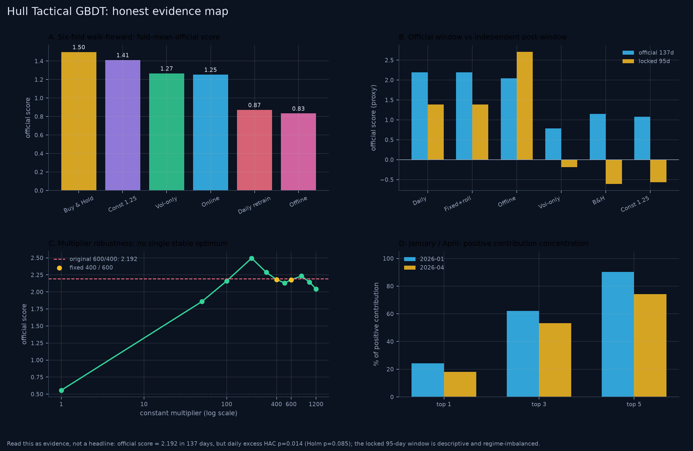

# Hull Tactical — 八个实验阶段

本文件记录 GBDT 研究管线背后的全部实证工作。实验按依赖顺序组织：先建立数据和验证契约，再比较模型与基准，之后压力测试验证协议，最后归因实盘结果和特征信号。

原来的 Phase 7（最终报告、决策记录、数据审计）是发布与综合阶段，不算第九个实验。八个实证阶段是：


除特别说明外，统一协议如下：

- 六个日历年折：2015、2017、2019、2021、2023、2025；
- 滚动 800 行训练窗口，1 日隔离间隔（purge gap）；
- 共 1,488 个测试交易日；
- 所有实验使用 `common.metrics.official_score` 和同一套仓位分配策略；
- OOF 文件是只读证据，实验不会改写正式预测。



---

## 1. 回放与六折验证

**问题：** 仓库能否复现提交的 notebook？样本外的滚动验证结果是什么？

**协议**

- 回放：用 `train.csv` 最后 800 行训练，逐行预测 `test.csv` 的 10 行，并对 9 行 `is_scored` 评分。
- CV：六个按日历年切分的滚动折；每折使用独立的 800 行训练窗口和 1 日隔离。
- 回放天然是样本内检查；CV 才是主要样本外估计。

**结果**

| 折 | 测试日数 | 日期范围 |
| --- | ---: | --- |
| 2015 | 252 | 6301–6552 |
| 2017 | 251 | 6805–7055 |
| 2019 | 252 | 7307–7558 |
| 2021 | 252 | 7812–8063 |
| 2023 | 250 | 8315–8564 |
| 2025 | 231 | 8817–9047 |
| **合计** | **1,488** | |

回放仓位与执行 notebook 的最大差异小于 `1e-6`。CV OOF 表是后续所有实验的输入。

**决策：** 六折 OOF 作为模型比较面；notebook 回放只作为一致性检查，不作为泛化估计。

---

## 2. 基准与消融

**问题：** 模型是否优于买入持有、固定仓位、仅波动率，或者去掉模型预测后的消融版本？

**实验组**

| 实验组 | 定义 |
| --- | --- |
| 买入持有 | 每天仓位 = 1.0。 |
| 固定仓位 | 仓位 = 0.25 / 0.50 / 0.75 / 1.25 / 1.50 / 2.00。 |
| 仅波动率 | `scale * median(训练窗口波动率) / 当前波动率`，再做同样的平滑和成本处理；scale 取 0.5 / 1.0 / 1.5。 |
| 常数预测消融 | 把 `raw_pred` 替换为训练窗口目标均值；保留乘数、波动率、平滑和成本。 |
| 现金 | `raw_pred = 0`，仓位 = 0。 |
| 预测置换 | 在每折内打乱预测顺序，保留波动率和乘数；重复 1,000 次。 |

**结果**

| 实验组 | 折均值 | 连续 OOF | 平均仓位 | 换手率 |
| --- | ---: | ---: | ---: | ---: |
| 买入持有 | **1.498** | **1.280** | 1.000 | 0.004 |
| 固定仓位 1.25 | 1.411 | 1.204 | 1.250 | 0.005 |
| 仅波动率 1.0x | 1.267 | 1.151 | 1.200 | 0.066 |
| GBDT 在线更新 | 1.253 | 1.271 | 0.652 | 0.515 |
| 每日重训 | 0.871 | 0.808 | 0.659 | 0.520 |
| GBDT 离线 | 0.833 | 0.419 | 0.495 | 0.303 |
| 常数预测消融 | 0.391 | 0.317 | 0.336 | 0.027 |
| 现金 | 0.000 | 0.000 | 0.000 | 0.000 |

同一六折 OOF 的风险与交易指标（连续拼接）：

| 策略 | 原始夏普（折均值） | 原始夏普（拼接） | 累计收益 | 最大回撤 | 换手率 | 平均仓位 |
| --- | ---: | ---: | ---: | ---: | ---: | ---: |
| 买入持有 | 1.498 | 1.280 | 203.9% | -18.0% | 0.001 | 1.000 |
| 固定仓位 1.25 | 1.481 | 1.264 | 283.3% | -22.3% | 0.001 | 1.250 |
| 仅波动率 1.0x | 1.486 | 1.329 | 354.9% | -20.6% | 0.066 | 1.200 |
| GBDT 在线更新 | 1.435 | 1.277 | 191.7% | -20.1% | 0.514 | 0.652 |
| 每日重训 | 1.114 | 0.966 | 134.1% | -19.3% | 0.520 | 0.659 |
| GBDT 离线 | 0.992 | 0.629 | 109.5% | -31.8% | 0.304 | 0.495 |

这里的“官方评分”不是普通夏普，而是包含波动率和收益惩罚的竞赛分数；原始夏普没有这两项惩罚。累计收益和最大回撤来自拼接后的 OOF 路径，不是连续账户；换手率是平均每日仓位变化。

分折差异很大：

| 折 | 买入持有 | 在线 | 离线 | 仅波动率 |
| --- | ---: | ---: | ---: | ---: |
| 2015 | 0.011 | 0.460 | 0.226 | 0.076 |
| 2017 | 2.784 | 0.521 | 0.316 | 2.942 |
| 2019 | 2.072 | 2.588 | 1.979 | 1.506 |
| 2021 | 2.105 | 1.205 | 2.360 | 1.917 |
| 2023 | 1.396 | 2.851 | 0.166 | 0.753 |
| 2025 | 0.618 | −0.107 | −0.049 | 0.405 |

**解读**

- 按折均值，模型没有跑赢买入持有或固定仓位 1.25；
- 在线模型接近仅波动率，说明结果中有相当一部分来自仓位缩放，而不是收益方向预测；
- 常数预测消融明显更差，说明预测内容不是零贡献，但不足以形成稳定优势。

**决策：** 后续每个实验都保留这些基准；不能只根据六折均值继续调模型。

---

## 3. 时间序列验证与暴露匹配

**问题：** 模型结果能否区别于时间置换零假设和因果暴露匹配基准？

**协议**

- 块置换（block permutation）：块长度 5、10、20、40、60，各 1,000 次；
- 循环移位（circular shift）零假设；
- 按折分层的配对移动块自助法（paired moving-block bootstrap），2,000 次；
- 因果暴露基准：`lag1`、扩展均值、波动率倾斜诊断和历史自助；
- 秩相关 IC、Pearson IC、预测分位收益和市场状态 IC。

**结果**

| 检验 | 结果 |
| --- | --- |
| 在线块置换，块长 20 | 实际 1.253，零假设均值 0.804，p=0.057，Holm p=0.200 |
| 在线循环移位 | 实际 1.253，零假设均值 0.763，p=0.050 |
| 在线 vs 买入持有 | −0.245，95% 置信区间 [−0.990, 0.509]，p=0.606 |
| 在线 vs 固定仓位 1.25 | −0.158，95% 置信区间 [−0.884, 0.544]，p=0.733 |
| 在线 vs 仅波动率 | −0.014，95% 置信区间 [−0.624, 0.682]，p=0.880 |
| 在线 vs `lag1` | +0.690，95% 置信区间 [−0.160, 1.218]，p=0.111 |
| 在线 RankIC | 0.0116，95% 置信区间 [−0.034, 0.064]，p=0.526 |
| 离线 RankIC | 0.0637，95% 置信区间 [0.024, 0.109]，p=0.002 |

只有 2023 折看起来较强；2017 折方向相反。预测分位收益不单调，市场状态 IC 不稳定。

**决策：** 下一阶段是部署一致性回放和因素归因，不是继续搜索模型。

---

## 4. 部署一致性的每日重训

**问题：** 生产协议能否复现在线 OOF 的优势？

**协议**

对每个测试日 `t`：

1. 只使用 `date_id < t` 且目标已实现的行；
2. 在最近 800 行上重新拟合特征构建器和三个模型；
3. 预测 `t` 的仓位；之后才把 `t` 的已实现目标送入仓位策略；
4. 每折开始时重置仓位状态。

这比固定构建器/在线更新更严格，因为特征构建器每天都会重建。

**结果**

| 策略 | 折均值 | 连续 OOF | 平均仓位 |
| --- | ---: | ---: | ---: |
| 在线（固定构建器 + 更新） | 1.253 | 1.271 | 0.652 |
| 每日重训（动态构建器 + 全量重训） | 0.871 | 0.808 | 0.659 |
| 离线（固定构建器 + 固定模型） | 0.833 | 0.419 | 0.495 |
| 买入持有 | 1.498 | 1.280 | 1.000 |
| 固定仓位 1.25 | 1.411 | 1.204 | 1.250 |
| 仅波动率 1.0x | 1.267 | 1.151 | 1.200 |

每日重训路径并不等同于提交 notebook。notebook 的在线更新分支在特征选择后不可达：`previous_lagged` 保存的是特征选择后的数据框，其中已经不再包含 lagged target，因此它实际上只训练一次，之后冻结预测。每日回放刻意实现了更严格的生产协议。

`E14` 从 2026-06-16 起在实盘源里缺失。该缺失与历史 CV 测试日期没有重叠，因此不能解释 OOF 差距。实盘任务保留 E14 并做中位数填补；数据接入会在 `health.json` 中报告缺失率。

**决策：** 不能把在线 OOF 说成部署一致性结果；每日重训才是部署估计。

---

## 5. 特征构建与重训归因

**问题：** 在线到每日重训的差距来自特征重建、每日模型更新，还是两者共同作用？

**设计**

|  | 固定模型 | 滚动模型 |
| --- | --- | --- |
| 固定构建器 | **A** 现有离线 | **B** 现有在线 |
| 动态构建器 | **C** 新增 Phase 4C OOF | **D** 现有每日重训 |

所有实验组使用相同折、标签、超参数、乘数、波动率窗口、平滑和交易成本。

**结果**

| 实验组 | 折均值 | 连续 OOF | 平均仓位 | 换手率 |
| --- | ---: | ---: | ---: | ---: |
| A 固定/固定 | 0.833 | 0.419 | 0.495 | 0.304 |
| B 固定/滚动 | 1.253 | 1.271 | 0.652 | 0.514 |
| C 动态/固定 | 0.524 | 0.329 | 0.402 | 0.221 |
| D 动态/滚动 | 0.871 | 0.808 | 0.659 | 0.520 |

直接对比：

| 对比 | 估计 | 95% 置信区间 |
| --- | ---: | --- |
| C − A：构建器效应，固定模型 | 负向 | 跨 0 |
| D − B：构建器效应，滚动模型 | 负向 | 跨 0 |
| B − A：重训效应，固定构建器 | 正向 | 跨 0 |
| D − C：重训效应，动态构建器 | 正向 | 跨 0 |

点估计指向“动态构建器负向、滚动模型正向”，但没有一个配对区间离开 0。预测相关性也不能替代仓位路径证据：A–C 原始预测相关性为 0.865，但截断和平滑后仓位差异很大。

**决策：** 没有配置具备稳健增量优势。停止进一步的 GBDT 结构搜索，把四组归因作为部署差距的解释。

---

## 6. 官方窗口归因与排行榜对齐

**问题：** 官方实盘窗口的分数来自哪里？本地代理、notebook 回放和最终 Kaggle 分数之间是什么关系？

### 官方评估期

Kaggle 竞赛时间线：

```text
最终提交截止：2025-12-15
实盘预测开始：2025-12-16
竞赛结束：2026-06-25
```

这对应 **131 个交易日**。仓库最初的 137 日窗口到 2026-07-06，是研究扩展窗口，不是官方私有评估期。

### 本地与排行榜结果

| 证据层 | 分数 | 含义 |
| --- | ---: | --- |
| 官方评估期，仓库每日代理 | 2.148 | 131 日重建 `fwd = target_metric, rf = 0` |
| 137 日研究扩展 | 2.192 | 本地代理，不是官方评估 |
| 本地逐行执行 `final_submission.ipynb` | 2.25 | 131 日 notebook 在实盘面板上的执行 |
| Kaggle 最终私有排行榜 | **3.263** | 被选中的 notebook 提交 |

131 日官方评估期的风险与交易指标（仓库代理，不是 Kaggle 私有排行榜）：

| 协议 | 代理评分 | 原始夏普 | 累计收益 | 最大回撤 | 换手率 | 平均仓位 |
| --- | ---: | ---: | ---: | ---: | ---: | ---: |
| 每日重训 | 2.148 | 2.148 | 11.50% | -4.01% | 0.524 | 0.709 |
| 固定构建器 + 滚动模型 | 2.152 | 2.152 | 11.52% | -4.01% | 0.529 | 0.713 |
| 离线 | 2.090 | 2.090 | 11.24% | -3.67% | 0.369 | 0.475 |
| 仅波动率 1.0x | 0.843 | 0.910 | 4.81% | -4.52% | 0.094 | 0.662 |
| 买入持有 | 0.860 | 0.860 | 6.36% | -9.66% | 0.008 | 1.000 |
| 固定仓位 1.25 | 0.803 | 0.843 | 7.85% | -11.97% | 0.010 | 1.250 |

`3.263` 是官方私有分数；`2.15–2.25` 是本地重建。差距不能仅用 800 行训练配置解释。要宣称复现，需要先固定被选中提交对应的 notebook 版本和评估数据快照。不要把本地代理覆盖成排行榜分数；两个标签都要保留。Kaggle 私有排行榜不提供与本地代理同口径的换手率和回撤。

### 137 日研究窗口的信号归因

本地归因使用的是 137 日研究扩展，因此下面的 `2.192` 不是官方 131 日分数。

| 变体 | 分数 |
| --- | ---: |
| 原始信号 + 原始仓位 | **2.192** |
| 反转信号 | 0.055 |
| 信号乘数 = 1 | 0.556 |
| 固定 400 | 2.181 |
| 固定 600 | 2.178 |
| 乘数 200（网格峰值） | 2.496 |

乘数曲线是一个宽平台，200 的点估计更高，但没有选择 200：用最佳窗口选参数就是测试窗口优化。原始 600/400 切换保留。

预测置换：

| 模式 | 实际值 | 零假设均值 | p |
| --- | ---: | ---: | ---: |
| 独立同分布（IID）置换 | 2.192 | 0.750 | 0.052 |
| 块置换，块长 20 | 2.192 | 0.738 | 0.052 |

结果为正，但不能干净地拒绝“时间顺序无关”。这个检验没有把信号层和仓位层完全分开。

**决策：** 官方分数和代理分数必须使用不同标签报告；不能根据实盘窗口排序选择乘数或模型。

---

## 7. 信号稳健性与锁定窗口

**问题：** 信号能否经受市场状态切分、集中度诊断、HAC 推断和独立的赛后窗口？

**协议**

- 市场状态（regime）来自因果的过去 20 日波动率（trailing volatility）和训练窗口阈值，在读取赛后窗口之前冻结；
- 信号 × 市场状态的 RankIC/Pearson IC、五分位 Q1–Q5 收益差；
- 乘数网格 [1, 50, 100, 200, 300, 400, 500, 600, 800, 1000, 1200]；
- 留一日（leave-one-day-out）和连续块删除（3 日和 5 日）；
- Newey–West/HAC，10 个滞后；块自助 2,000 次；六个预注册检验做 Holm 校正；
- 锁定窗口：2026-07-07 至 2026-11-17，共 95 日。

**官方窗口推断**

| 假设 | 估计 | HAC t | 原始 p | Holm p |
| --- | ---: | ---: | ---: | ---: |
| 日度平均超额收益 > 0 | 0.000859 | 2.193 | 0.0283 | 0.0849 |
| 每日 − 买入持有 | 0.000193 | 0.330 | 0.742 | 1.000 |
| 每日 − 固定仓位 1.25 | 0.000027 | 0.036 | 0.971 | 1.000 |
| 每日 − 仅波动率 | 0.000439 | 1.099 | 0.272 | 0.679 |
| RankIC > 0 | 0.1144 | — | 自助法 0.485 | 1.000 |
| Q5 − Q1 > 0 | 0.002575 | — | 自助法 0.389 | 1.000 |

没有任何预注册检验在 5% 水平通过 Holm 校正。

**集中度**

| 月份 | 天数 | 最大单日占比 | 前 3 日占比 | 前 5 日占比 |
| --- | ---: | ---: | ---: | ---: |
| 2026-01 | 20 | 24.3% | 62.1% | 90.3% |
| 2026-04 | 21 | 18.1% | 53.3% | 74.2% |

收益集中在少数交易日。删除五日块就可能显著改变分数；点估计不是广泛存在的日度优势。

**锁定 95 日窗口**

| 策略 | 分数 | 原始夏普 | 累计收益 | 最大回撤 | 换手率 | 平均仓位 |
| --- | ---: | ---: | ---: | ---: | ---: | ---: |
| 每日重训 | 1.382 | 1.382 | 7.42% | −4.70% | 0.704 | 0.867 |
| 固定滚动 | 1.382 | 1.382 | 7.42% | −4.70% | 0.704 | 0.867 |
| 离线 | 2.711 | 2.711 | 10.98% | −1.05% | 0.393 | 0.354 |
| 仅波动率 | −0.185 | −0.776 | −6.99% | −12.60% | 0.021 | 1.955 |
| 买入持有 | −0.607 | −0.607 | −2.82% | −6.33% | 0.011 | 1.000 |
| 固定仓位 1.25 | −0.567 | −0.623 | −3.60% | −7.90% | 0.013 | 1.250 |

锁定窗口有 92 个低波动日、3 个中波动日，没有高波动日。正的点估计是特定市场状态下的结果，没有达到预期的推断标准。

**决策：** 冻结 GBDT；不根据锁定窗口选择乘数、状态规则或模型。

---

## 8. 特征级 RankIC

**问题：** 哪些特征与未来收益存在持续的时间序列秩相关信息？模型输入的冗余程度如何？

**协议**

- 1,488 个 OOF 日期、六个折；
- 94 个原始特征 + 5 个衍生特征 → 99 个模型输入并集；
- 按折构建时点特征，每次只构建一个日期；
- 计算总体、分折和滚动 RankIC；滚动窗口 60/120 日；
- 市场状态来自因果的过去 20 日波动率（trailing volatility）；
- 按折分层的移动块自助法和 Benjamini–Hochberg 错误发现率。

**特征稳定性**

| 标签 | 特征数 |
| --- | ---: |
| 稳定正向 | 22 |
| 稳定负向 | 20 |
| 单一时期 | 53 |
| 方向混合 | 3 |
| 样本不足（少于四折） | 1（`E7`） |

**BH 显著特征**

| 特征 | 平均 RankIC | q_BH | 95% 自助区间 |
| --- | ---: | ---: | --- |
| E19 | 0.110 | 0.00185 | [0.0599, 0.1442] |
| M1 | 0.115 | 0.00274 | [0.0583, 0.1395] |
| V7 | 0.104 | 0.00274 | [0.0561, 0.1344] |
| V9 | 0.102 | 0.00610 | [0.0535, 0.1270] |
| V13 | 0.072 | 0.01565 | [0.0468, 0.1238] |
| V10 | 0.101 | 0.05207 | [0.0364, 0.1194] |

`V10` 在模型输入层是边界情况，在原始特征层显著（q=0.005）。`P2` 和 `P11` 的分折均值方向很强，但总体合并 IC 较弱；不能把它们当作稳定发现。

**冗余**

- `D1` 与 `D2` 完全重复；
- 14 对特征的绝对 Spearman 相关系数 >= 0.90；
- 10 个高相关簇，包括 `V1/V2/V4/V8`、`V7/V9/V10`、`E3/P11`、`I2/U1`、`S1/V1_S1`、`M11/M11_V1`。

**市场状态**

高波动桶有 292 个测试日，分布在三个可用折；所有高波动单元格都标记为样本不足（inconclusive）。只有低/中波动状态有足够覆盖度做描述性分析。

**决策：** 特征诊断用于解释模型输入结构，不用于选特征。模型保持冻结。

---

## 跨阶段汇总

| # | 实验 | 主要结果 | 决策 |
| --- | --- | --- | --- |
| 1 | 回放与 CV | notebook 一致性 <1e-6；1,488 个 OOF 日 | 使用六折 OOF |
| 2 | 基准与消融 | 买入持有 1.498；在线 1.253；每日 0.871；离线 0.833 | 没有稳定模型优势 |
| 3 | 时间序列验证 | 配对置信区间跨 0；IC 较弱 | 进入部署回放 |
| 4 | 部署回放 | 每日 0.871，低于简单基准 | 生产协议更弱 |
| 5 | 2×2 归因 | 动态构建器负向、滚动模型正向；区间跨 0 | 停止 GBDT 搜索 |
| 6 | 官方窗口 | 131 日代理 2.148；137 日扩展 2.192；私有排行榜 3.263 | 分开标注 |
| 7 | 稳健性与锁定 | HAC 原始 p=0.028，Holm 0.085；锁定窗口正向但依赖状态 | 冻结 GBDT |
| 8 | 特征级 RankIC | 5/99 通过 BH；D1/D2 重复；14 对高相关 | 只诊断，不选特征 |

这个顺序是有意设计的：实盘窗口看起来好，不等于模型有效；必须同时理解部署协议、仓位归因、多重检验和特征结构。

---

## 复现命令

```bash
# 回放与 CV
python scripts/run_replay.py --no-wandb
python scripts/run_cv.py --offline --no-wandb

# 基准与验证
python scripts/run_experiments.py --shuffles 1000
python scripts/run_validation.py

# 部署与归因
python scripts/run_daily_retrain.py
python scripts/compare_deployment_modes.py
python scripts/run_phase4_dynamic_fixed.py
python scripts/run_feature_builder_attribution.py

# 实盘窗口与稳健性
python scripts/score_live_window.py \
  --start 2025-12-16 --end 2026-06-25 \
  --warmup-start 2025-12-16 \
  --output reports/live_window_20251216_20260625
python scripts/run_phase5_window_attribution.py
python scripts/run_phase6_signal_robustness.py

# 特征诊断
python scripts/run_phase8_feature_rankic.py \
  --config configs/gdbt/phase8.yaml
```

生成的产物写入 `reports/` 和 `models/`，两者都被 gitignore。脚本和配置进入版本控制；原始数据由 `data/manifest.json` 保护。

---

## 支撑报告

| 报告 | 范围 |
| --- | --- |
| [`repro_gdbt.md`](repro_gdbt.md) | 环境、入口和产物清单 |
| [`gbdt_validation.md`](gbdt_validation.md) | Phase 2b 时间零假设、自助法和暴露匹配 |
| [`deployment_eval.md`](deployment_eval.md) | Phase 3 部署一致性评估和 E14 |
| [`feature_builder_attribution.md`](feature_builder_attribution.md) | Phase 4 2×2 归因 |
| [`phase5_competition_window_attribution.md`](phase5_competition_window_attribution.md) | Phase 5 信号/仓位归因 |
| [`phase6_preregistration.md`](phase6_preregistration.md)、[`phase6_signal_robustness.md`](phase6_signal_robustness.md) | Phase 6 协议和锁定窗口结果 |
| [`feature_rankic_analysis.md`](feature_rankic_analysis.md) | Phase 8 特征诊断 |
| [`feature_engineering.md`](feature_engineering.md) | 特征契约和选择依据 |
