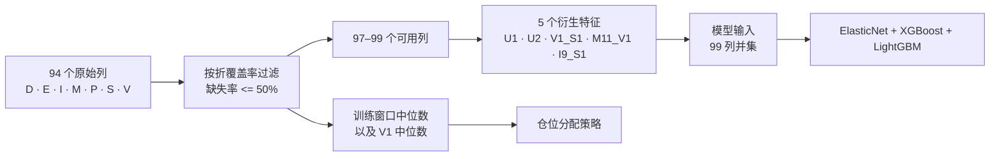

# 特征工程

本文定义 GBDT 管线使用的特征契约、衍生特征和选择规则。目标不是堆一个很大的因子库，而是保留比赛特征的原始语义，只加入少量有明确来源的变换，并让每个折的模型输入可复现。

先给结论：

- **94 个原始特征**由比赛提供，全部是匿名列；
- **5 个衍生特征**来自提交的 notebook；
- 按折做**覆盖率过滤**，每折最终有 97–99 个可用输入；
- 不按目标相关性、特征重要性或测试分数选择特征。

本文只讨论特征契约和特征诊断，不报告策略的夏普、换手率或回撤；这些绩效指标见 [`README.md`](../README.md) 和 [`experiments.md`](experiments.md)。

---

## 1. 特征流



过滤器只在训练窗口上拟合，不使用全量面板。不同折可能得到不同列数；模型和报告都会保存当折的精确特征列表。

---

## 2. 原始特征契约

原始数据包含七个匿名特征组：

| 前缀 | 数量 | 在模型中的使用 |
| --- | ---: | --- |
| `D` | 9 | 作为原始市场状态列 |
| `E` | 20 | 作为原始市场状态列 |
| `I` | 9 | 使用；`I2` 还用于构造 `U1` |
| `M` | 18 | 使用；`M11` 用于构造 `U2` 和 `M11_V1` |
| `P` | 13 | 使用 |
| `S` | 12 | 使用；`S1` 用于构造 `V1_S1` 和 `I9_S1` |
| `V` | 13 | 使用；`V1` 用于构造 `V1_S1`、`M11_V1` 和波动率仓位 |
| **合计** | **94** | |

这些字母是比赛做的匿名化模型把它们当作一个宽泛的市场状态表示。

### 为什么保留全部 94 个原始列

1. **比赛把它们定义为特征全集。** 删列会改变提交模型，破坏 notebook 一致性。
2. **样本很小。** 在 1,488 个交易日上对 94 列做性能驱动的搜索，很容易过拟合折结构。
3. **模型族本来就适合相关输入。** ElasticNet 用正则化约束系数；树模型通过分裂处理冗余和非线性。先给一个宽输入，再让模型通过正则化和分裂做自己的选择。
4. **覆盖度显式处理。** 某一折不可用的列由训练窗口缺失率过滤，不用未来信息填补。

---

## 3. 衍生特征

提交 notebook 定义了五个逐行变换。它们都只使用当前行，不使用未来行。

| 特征 | 公式 | 用途 |
| --- | --- | --- |
| `U1` | `I2 - I1` | 两个同组指标的差；去掉共同水平，保留相对状态。 |
| `U2` | `M11 / ((I2 + I9 + I7) / 3)` | 一个指标相对另外三个指标局部均值的无量纲比率。 |
| `V1_S1` | `V1 * S1` | 波动率/状态代理与信号状态的交互。 |
| `M11_V1` | `M11 * V1` | `M11` 在当前波动率状态下的条件版本。 |
| `I9_S1` | `I9 * S1` | `I9` 在当前信号状态下的条件版本。 |

为什么是这五个：

- 它们来自提交 notebook 的特征路径；保留它们是复现要求。
- 它们是**低维、逐行**的变换，不会在小样本上引入第二轮特征搜索。
- 差分和比率降低了尺度依赖；交互项给模型一个很小、显式的方式，让特征随市场状态变化。
- 原始列仍然保留，所以这些变换是补充信息，不是替代原始信息。

不作为模型输入的内容：

- `I2_MA66` 在 notebook 和本地构建器中计算后立即被 `select` 丢弃，没有进入训练、交叉验证或实盘推理的模型输入。
- `S1_lag1`、`P1_lag1`、`I9_lag1`、`V1_roll_mean_5`、`target_roll_std_5` 是训练期诊断；计算后会丢弃，不参与拟合。
- `I9_S1` 和其他交互项都是逐行计算，不使用滚动窗口。

这个区分很重要：**代码里出现某一列，不等于它是模型输入**。

---

## 4. 每个折的模型输入

模型输入并集是 99 列：94 个原始特征 + 5 个衍生特征。按折构建时，如果某列在训练窗口的缺失率超过 0.5，就会被丢弃。

| 折 | 模型输入数 | 说明 |
| --- | ---: | --- |
| 2015 | 97 | `E7` 和 `V10` 不可用 |
| 2017 | 98 | `E7` 不可用 |
| 2019 | 98 | `E7` 不可用 |
| 2021 | 99 | 并集全部可用 |
| 2023 | 99 | 并集全部可用 |
| 2025 | 99 | 并集全部可用 |

Phase 8 诊断使用并集，保证每个特征都有报告；实际训练和推理使用当折列表。

### 缺失情况

| 特征 | 有效 OOF 行 | 缺失占比 | 可用折数 |
| --- | ---: | ---: | ---: |
| `E7` | 733 / 1,488 | 50.7% | 3 |
| `V10` | 1,236 / 1,488 | 16.9% | 5 |

`E7` 在特征稳定性分析中标记为 `insufficient`，因为它不足四折。`V10` 解释了为什么模型输入层是边界显著、原始特征层却显著：同一个列在两个视图中的覆盖度不同。

实盘源还有已知的 `E14` 缺失，从 2026-06-16 开始。每日管线保留 E14（它最近 800 行的缺失率低于 0.5）并做中位数填补；数据接入会在 `health.json` 中报告这个缺失。这是运行告警，不是静默填零。

---

## 5. 特征选择策略

项目使用**契约优先**（contract-first）策略：

| 决策 | 规则 |
| --- | --- |
| 原始列 | 保留全部 94 个比赛特征。 |
| 衍生列 | 只保留 notebook 的五个变换。 |
| 覆盖率过滤 | 只有训练窗口缺失率超过 0.5 才删列。 |
| 性能过滤 | 无。不会因为单变量 IC、模型重要性或回测贡献低而删特征。 |
| RankIC 过滤 | 无。Phase 8 只做诊断，不产出特征列表。 |
| 测试窗口选择 | 禁止。最终模型不会在实盘/私有期重新排序。 |
| 生产列表 | 当折特征列表随模型保存，推理前校验。 |

这是有意设计的。94 列、1,488 个 OOF 日，如果在同一批折上选一个小特征集，再在同一批折上测性能，就会多出一层没有被计入的选择偏差。项目选择保留宽输入，让正则化和树分裂处理冗余，再诚实测量得到的信号。

### 为什么不直接选五个 BH 显著特征

Phase 8 找到五个模型输入特征满足 BH q <= 0.05：

```text
E19 · M1 · V7 · V9 · V13
```

这是有用的诊断：模型输入中确实存在具有持续时间序列秩相关的特征。但它不是特征选择指令：

- 检验是单变量的，不衡量条件贡献；
- 这些特征和其他列相关，删掉其他列会改变模型，使冻结比较失效；
- 结果是在发现它的同一批 OOF 日期上测的；
- 按这个排序选特征，会把诊断变成又一轮调参。

因此特征集合保持不变。

---

## 6. 冗余

99 个输入不是 99 个独立信号。模型输入值的两两 Spearman 相关显示：

- `D1` 与 `D2` 完全重复（rho = 1.000）；
- 14 对特征满足 `|rho| >= 0.90`；
- 10 个连通簇，包括：
  - `V1`、`V2`、`V4`、`V8`
  - `V7`、`V9`、`V10`
  - `E3`、`P11`
  - `I2`、`U1`
  - `S1`、`V1_S1`
  - `M11`、`M11_V1`

重复列**没有删除**，因为 notebook 一致性契约要求使用相同输入列。未来的生产模型可以去重，但那是一个新模型版本，必须单独评估。

---

## 7. 泄漏与稳定性控制

特征路径和模型使用同一条时间边界：

1. 训练窗口中位数只用预测日之前的行拟合；
2. 缺失率过滤使用训练窗口，不使用全量面板；
3. 原始特征在日期 `t` 读取，目标是之后已实现的收益；
4. 衍生特征是当前行的逐行变换；
5. 训练期 lag 和滚动统计量不进入最终输入列表；
6. 一致性构建器是隔离的：它复现 notebook 的历史填充行为，包括 I 列的填充规则，但不作为前瞻性特征收益的证据；
7. Phase 8 重建每次只构建一个测试日，并验证“把面板截断到日期 `d`”不会改变 `<= d` 的行。

Phase 8 使用的截断检查在测试折上的最大绝对特征差异是 `0.0`。

---

## 8. 经验诊断

完整报告见 [`feature_rankic_analysis.md`](feature_rankic_analysis.md)。关键数字：

| 诊断 | 结果 |
| --- | --- |
| 稳定正向特征 | 22 / 99 |
| 稳定负向特征 | 20 / 99 |
| BH 显著的模型输入特征 | 5 / 99 |
| 完全重复对 | `D1`、`D2` |
| 绝对 rho >= 0.90 的特征对 | 14 |
| 折数足够的高波动特征单元 | 0（所有高波动单元都是 inconclusive） |

代表性分折平均 RankIC：

| 特征 | 平均 RankIC | 正向折数 | q_BH |
| --- | ---: | ---: | ---: |
| `E19` | 0.110 | 6/6 | 0.00185 |
| `M1` | 0.115 | 6/6 | 0.00274 |
| `V7` | 0.104 | 6/6 | 0.00274 |
| `V9` | 0.102 | 6/6 | 0.00610 |
| `V13` | 0.072 | 6/6 | 0.01565 |
| `V10` | 0.101 | 5/5 可用折 | 0.05207 |

`P2` 和 `P11` 说明分折均值和合并 IC 必须一起读：两者六折方向都很强，但合并 IC 较弱，也没有通过 BH。不能把它们包装成特征发现。

---

## 9. 安全地新增特征

未来新增特征必须走这个清单：

1. 把它定义为日期 `t` 或之前可用数据的逐行函数；
2. 任何统计量（中位数、缩放器、覆盖阈值）只在训练窗口拟合；
3. 加截断测试：把面板截断到 `d` 时，`<= d` 的行特征必须完全一致；
4. 把它写入模型输入契约，并随模型保存列表；
5. 在不改仓位策略和超参数的前提下，跑六折对比冻结基准；
6. 在 OOF 上报告结果；如果使用锁定窗口，也单独报告。不能用私有排行榜选特征。

只在实盘分数上变好、但截断测试或分折稳定性不通过的特征，不加入。

---

## 10. 产物

| 产物 | 内容 |
| --- | --- |
| `gdbt/features.py` | `NotebookFeatureBuilder`、衍生特征和一致性路径 |
| `common/schema.py` | 94 特征 schema 和校验 |
| `configs/gdbt/notebook.yaml` | 800 行训练和仓位配置 |
| `reports/feature_rankic_summary.csv` | 特征级 RankIC 汇总 |
| `reports/feature_correlation_matrix.csv` | 特征两两相关 |
| `reports/feature_rankic_regime.csv` | 市场状态拆分 |
| `docs/feature_rankic_analysis.md` | Phase 8 完整报告 |

复现特征诊断：

```bash
python scripts/run_phase8_feature_rankic.py \
  --config configs/gdbt/phase8.yaml
```
