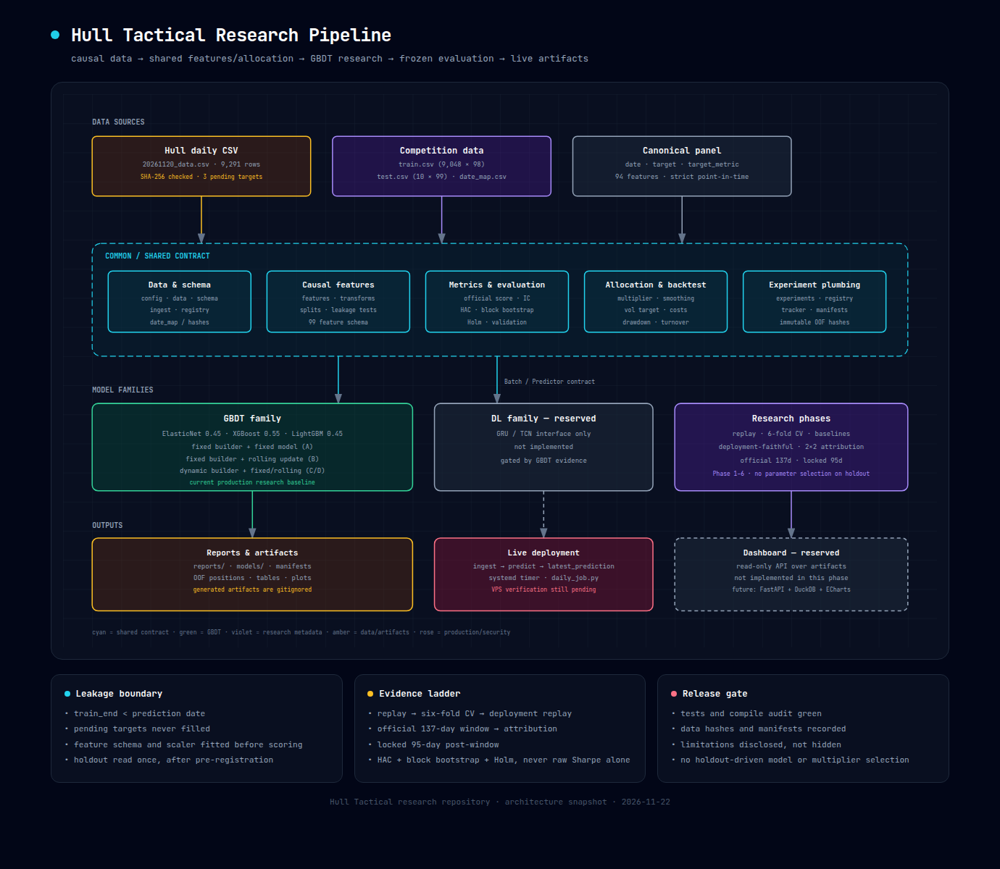
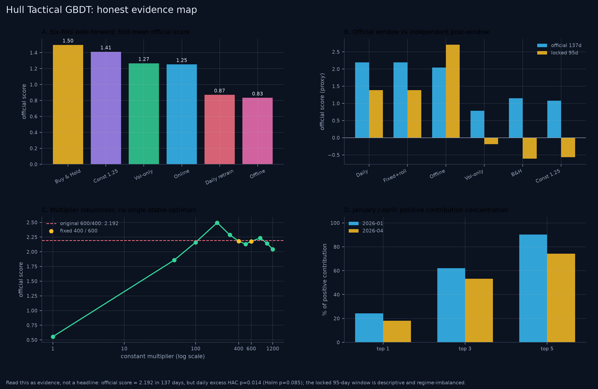

# Hull Tactical GBDT — 最终研究报告

- 日期：2026-11-22
- 仓库：`/home/yys/Hull_Tactical_solution`
- 范围：六折滚动前推（walk-forward）、部署口径回放、137 日研究扩展窗口、95 天锁定测试窗口、信号稳健性、最终审计。
- 状态：GBDT 研究冻结；DL 尚未实现。

> 口径说明：竞赛官方评估期为 **2025-12-16 至 2026-06-25（131 个交易日）**；本文的 137 日窗口是研究扩展，不是官方私有评估期。正文保留原始研究口径和数字，但引用时不要把它当成官方排行榜窗口。



## 1. 执行摘要

这项工作聚焦一个更窄、更重要的问题：

> 现有 GBDT 信号在严格时间顺序、统一的仓位分配/成本模型和多种统计检验下，
> 是否真的优于买入持有（Buy & Hold）、固定仓位（Constant 1.25）和仅波动率（Vol-only）？

结论分成三层：

1. **六折滚动前推没有证明稳定的增量价值。** 六折均值：
   买入持有 **1.498**、固定仓位 1.25 **1.411**、仅波动率 **1.267**、
   在线（Online）**1.253**、每日重训（Daily Retrain）**0.871**、离线（Offline）**0.833**。
   多组配对自助法区间跨 0；不能把在线的 1.253 说成稳定 alpha。
2. **137 日研究扩展窗口的点估计很强，但证据不稳健。**
   每日重训的官方公式复算为 **2.192**，累计收益 12.21%，MDD −4.01%；
   但信号反转、乘数、平滑、月份和市场状态（regime）归因显示，分数主要
   由敞口层（exposure layer）和少数月份/交易日驱动。Phase 6 的 HAC 检验中，
   日度超额均值的单侧原始 p=0.014，但六项检验经 Holm 校正后 p=0.085。
3. **锁定的 95 天窗口没有确认稳定性。** 2026-07-07 至 2026-11-17 的每日重训
   分数为 1.382、离线为 2.711，但 HAC 检验全部不显著；赛后窗口的
   市场状态严重不平衡（低波动 92 天、中波动 3 天、没有高波动）。离线
   的 2.711 是描述性结果，不能反过来作为选择模型的依据。

**最终决策：** 冻结 GBDT 作为研究基线；不再用单一窗口调乘数、特征或
模型；不启动 DL，除非先定义新的、独立的、预注册的验证问题。

## 2. 研究问题与贡献

### 2.1 问题

Hull Tactical 的评分不是普通 Sharpe：

```text
strategy = rf * (1 - position) + position * fwd
score    = annualized_sharpe / (vol_penalty * return_penalty)
```

其中 `vol_penalty` 只在策略波动超过市场 1.2 倍时增加，`return_penalty`
只在策略平均收益低于市场时增加。这个非线性评分会让“低仓位、低波动但收益不足”
的路径看起来与高 Sharpe 路径很不一样。因此，本项目的核心是预测信号到仓位分配的完整链路：

- 预测信号是否提供了增量方向信息；
- 仓位分配 / 乘数 / 平滑是否在替代信号贡献；
- 这些结论是否能跨折、跨市场状态、跨时间窗口成立；
- 在真实交易成本、集中度和多重检验下还剩下什么。

### 2.2 贡献

- 把 notebook 风格的 GBDT 研究拆分为共享层 `common/`、模型族 `gdbt/` 和预留的
  `dl/`；
- 实现了严格贴合部署口径的每日重训回放（strict deployment-faithful daily retrain
  replay），明确 `train_end < t`；
- 用 2×2 析因设计分离特征构建器漂移与模型重训；
- 用官方评分脚本复算 137 日研究扩展窗口，并做信号/仓位分配消融；
- 在读取赛后窗口数据之前预注册乘数网格、市场状态阈值、集中度
  规则和 HAC/分块自助法/Holm 检验族。

## 3. 数据、架构与因果协议

### 3.1 数据

| 数据 | 规模 | 说明 |
| --- | ---: | --- |
| `data/train.csv` | 9,048 × 98 | 1990-01-02 起的比赛训练数据；94 个特征 + `date_id` + 三个收益字段 |
| `data/test.csv` | 10 × 99 | 10 个回放行；不等于独立样本 |
| `data/date_map.csv` | 9,291 × 2 | `date_id` 到日历日期，覆盖到 2026-11-20 |
| `data/lake/panel_live.parquet` | 9,291 × 100 | 实时日度数据表；最后 3 个目标值待定；由 git 忽略 |
| `data/raw/hull/20261120_data.csv` | 9,291 × 96 | 原始 Hull CSV；由 git 忽略 |

完整哈希、行数、列数和日期范围见 `data/manifest.json` 与
`docs/data_manifest.md`。

### 3.2 架构

- `common/`：config、data、schema、features、transforms、splits、metrics、
  allocation、backtest、pipeline、ingest、registry、tracker、validation、
  evaluation；
- `gdbt/`：ElasticNet + XGBoost + LightGBM，notebook 对齐构建器（notebook parity
  builder）与生产构建器分开；
- `dl/`：只有接口预留，当前没有实现；
- `configs/`：base、CV、Phase 4、Phase 5、Phase 6；
- `scripts/`：replay、CV、baseline、validation、daily retrain、Phase 4/5/6；
- `deploy/`：systemd 定时器/服务；VPS 实机尚未验证；
- `docs/assets/`：架构图和核心结果图。

关键约束：

- 每个预测日只使用 `date_id < t` 且目标值已实现的数据；
- `train_end < t` 是强制校验，不是注释；
- 实时数据中待定的目标值不填 0；
- 缺失特征用训练窗口中位数填充；E14 当前保持中位数填充；
- 所有仓位分配规则和交易成本必须在比较中保持一致。

### 3.3 评估窗口

| 口径 | 日期/样本 | 用途 |
| --- | --- | --- |
| Notebook 回放 | `test.csv` 10 行 | 只验证代码对齐，不当作泛化 |
| 六折滚动前推 | 2015/2017/2019/2021/2023/2025，共 1,488 天 | 主样本外比较 |
| 部署回放 | 同六折 | 严格每日重训口径 |
| 官方实时窗口 | 2025-12-16–2026-07-06，137 天 | 官方公式复算与归因 |
| 锁定测试窗口 | 2026-07-07–2026-11-17，95 天 | 预注册后的独立验证；最后 3 个目标值待定 |

实时数据缺少真实的 `forward_returns` / `risk_free_rate`；官方分数使用
`fwd = target_metric, rf = 0` 的代理。这个代理与此前 2.192 的复算同口径，
但不是隐藏排行榜分数。

## 4. 结果



### 4.1 六折滚动前推：没有稳定的增量价值

| 策略 | 折均值官方分数 | 连续分数 | 平均原始 Sharpe | 平均仓位 | 换手率 |
| --- | ---: | ---: | ---: | ---: | ---: |
| 买入持有 | **1.498** | 1.280 | 1.498 | 1.000 | 0.004 |
| 固定仓位 1.25 | **1.411** | 1.204 | 1.481 | 1.250 | 0.005 |
| 仅波动率 1.0x | 1.267 | 1.151 | 1.486 | 1.200 | 0.066 |
| 在线 GBDT | 1.253 | 1.271 | 1.435 | 0.652 | 0.515 |
| 每日重训 | 0.871 | 0.808 | 1.114 | 0.659 | 0.520 |
| 离线 GBDT | 0.833 | 0.419 | 0.992 | 0.495 | 0.303 |

解读：

- 在线只比仅波动率低约 0.014 的折均值分数，远小于它与 B&H 的差距；
- 每日重训在更严格的部署口径下没有复现线上的优势，反而低于所有简单
  基准；
- 按折配对的差值在多个折上方向分散，均值仍为负；
- 因此，**历史 OOF 没有证明稳定的增量价值**。详见 `docs/gbdt_validation.md`、
  `docs/deployment_eval.md`。

### 4.2 贴合部署的每日重训与 2×2 归因

Phase 3 在每个预测日重新拟合特征构建器和三个模型，并且只使用当时已实现的
最近 800 行。六折结果：每日重训 0.871，低于在线 1.253、B&H 1.498、
固定仓位 1.25 1.411、仅波动率 1.267。

Phase 4 用 2×2 析因设计分离两个因素：

| 分组 | 构建器 | 模型 | 折均值分数 |
| --- | --- | --- | ---: |
| A | fixed | fixed | 0.833（离线） |
| B | fixed | rolling | 1.253（在线） |
| C | dynamic | fixed | 0.524（Phase 4C） |
| D | dynamic | rolling | 0.871（每日重训） |

点估计显示动态构建器呈负向、滚动模型呈正向，但四个直接对比
的配对分块自助法 95% CI 全部跨 0，Holm 校正后全部不显著。结论只能是
**描述性**：没有足够证据把在线→每日重训的差距归因为单一机制。详见
`docs/feature_builder_attribution.md`。

### 4.3 137 日研究扩展窗口

研究扩展窗口结果（官方公式，`fwd=target_metric, rf=0`）：

| 协议 | 官方分数 | 原始 Sharpe | 累计收益 | MDD | 换手率 | 平均仓位 |
| --- | ---: | ---: | ---: | ---: | ---: | ---: |
| 每日重训 | **2.192** | 2.192 | 12.21% | −4.01% | 0.530 | 0.711 |
| 固定构建器 + 滚动模型 | 2.196 | 2.196 | 12.23% | −4.01% | 0.535 | 0.714 |
| 离线 | 2.043 | 2.043 | 11.24% | −3.67% | 0.353 | 0.455 |
| 仅波动率 1.0x | 0.782 | 1.038 | 5.66% | −4.52% | 0.091 | 0.652 |
| 买入持有 | 1.152 | 1.152 | 9.00% | −9.66% | 0.007 | 1.000 |
| 固定仓位 1.25 | 1.081 | 1.135 | 11.19% | −11.97% | 0.009 | 1.250 |

这个窗口是第一个模型明显领先简单基准的真实样本外窗口。但它仍然只有一个
实现路径；下面的归因和锁定测试窗口是在检验它能否成为可重复的结论。

### 4.4 信号与仓位分配归因

Phase 5 在已保存的路径上做消融，不重新训练：

| 变体 | 官方分数 | 累计收益 | MDD | 换手率 | 平均仓位 |
| --- | ---: | ---: | ---: | ---: | ---: |
| 原始信号 + 仓位分配 | **2.192** | 12.21% | −4.01% | 0.530 | 0.711 |
| 反转原始信号 | 0.055 | 1.28% | −11.15% | 0.463 | 0.627 |
| 无乘数（`multiplier=1`） | 0.556 | 0.34% | −0.15% | 0.016 | 0.015 |
| 固定 600 | 2.178 | 13.96% | −4.83% | 0.571 | 0.829 |
| 固定 400 | 2.181 | 12.13% | −4.01% | 0.529 | 0.706 |
| 无平滑 | 2.014 | 12.81% | −4.91% | 0.733 | 0.712 |

结论：

- 方向有贡献：反转信号把分数打到 0.055；
- 但原始信号单独不足以建立仓位：multiplier=1 时平均仓位 0.015、分数 0.556；
- 600/400 切换不是主要来源：固定 400/600 与原始 2.192 非常接近；
- 平滑对风险调整分数有帮助：去掉后换手率上升、MDD 恶化；
- 预测分箱不单调，rank IC 0.114，shuffle p≈0.052；这不是干净的
  择时 alpha。

### 4.5 信号 × 市场状态、乘数与集中度

**信号 × 市场状态（137 日研究扩展）**

| 市场状态 | 天数 | Rank IC | Pearson IC | Q5−Q1 | Q1..Q5 计数 |
| --- | ---: | ---: | ---: | ---: | --- |
| 低波动 | 21 | 0.314 | 0.373 | 0.00878 | 5/4/4/4/4 |
| 中波动 | 21 | 0.164 | 0.366 | 0.00403 | 5/4/4/4/4 |
| 高波动 | 95 | 0.077 | 0.017 | −0.00005 | 19/19/19/19/19 |

低/中波动看起来有信号，但各只有 21 天、每个分位只有 4–5 天；高波动
95 天几乎为零。赛后窗口的低波动 92 天、中波动 3 天、没有高波动，
市场状态分布已经变化，不能把研究扩展窗口的模式外推。

**乘数（研究扩展窗口，预注册网格）**

| 乘数 | 平均仓位 | 分数 | 累计收益 | MDD | 换手率 |
| ---: | ---: | ---: | ---: | ---: | ---: |
| 原始 600/400 | 0.711 | 2.192 | 12.21% | −4.01% | 0.530 |
| 1 | 0.015 | 0.556 | 0.34% | −0.15% | 0.016 |
| 100 | 0.309 | 2.161 | 6.21% | −1.42% | 0.251 |
| 200 | 0.469 | **2.496** | 9.00% | −2.13% | 0.365 |
| 400 | 0.706 | 2.181 | 12.13% | −4.01% | 0.529 |
| 600 | 0.829 | 2.178 | 13.96% | −4.83% | 0.571 |
| 800 | 0.904 | 2.233 | 15.89% | −5.28% | 0.599 |

200 的点估计最高，但这是事后观察；100–800 是宽平台，400/600 几乎
等价。更简单的固定乘数在机制上可行，但**不能**根据这个窗口选 200。

**集中度（2026-01 与 2026-04）**

| 月份 | 天数 | Top1 占比 | Top3 占比 | Top5 占比 | 达到 50% 的正贡献天数 |
| --- | ---: | ---: | ---: | ---: | ---: |
| 2026-01 | 20 | 24.3% | 62.1% | 90.3% | 3 |
| 2026-04 | 21 | 18.1% | 53.3% | 74.2% | 3 |

删除 2026-04-10 至 2026-04-16 的 5 日区块，分数下降 **0.653**；删除
2026-01-20 至 2026-01-26 的 5 日区块，分数下降 **0.382**。逐日
留一法的最大单日影响是 2026-04-16 的 −0.214。这个 2.192 不是由很多
小优势平均累积出来的。

### 4.6 统计推断

研究扩展窗口六项预注册检验（HAC 10 阶滞后；分块自助法 block=20，B=2,000；
Holm 校正）：

| 假设 | 估计值 | HAC t | 原始单侧 p | Holm p |
| --- | ---: | ---: | ---: | ---: |
| 日度平均超额 > 0 | 0.000859 | 2.193 | 0.014 | **0.085** |
| 每日重训 vs 买入持有 | 0.000193 | 0.330 | 0.371 | 1.000 |
| 每日重训 vs 固定仓位 1.25 | 0.000027 | 0.036 | 0.486 | 1.000 |
| 每日重训 vs 仅波动率 | 0.000439 | 1.099 | 0.136 | 0.679 |
| Rank IC > 0 | 0.114 | — | 0.485 | 1.000 |
| Q5−Q1 > 0 | 0.002575 | — | 0.389 | 1.000 |

分数差自助法：

| 配对 | 分数差 | 95% CI | 双侧 p |
| --- | ---: | ---: | ---: |
| 每日重训 − 买入持有 | 1.040 | [−3.554, 3.368] | 0.474 |
| 每日重训 − 固定仓位 1.25 | 1.111 | [−3.349, 3.247] | 0.455 |
| 每日重训 − 仅波动率 | 1.411 | [−0.239, 4.106] | 0.101 |

原始分数 2.192 不能单独作为证据。经多重检验后，没有任何预注册检验达到 5%
显著水平；结论是“没有检出可靠差异”，不足以支持“模型更好”的判断。

### 4.7 锁定测试窗口

2026-07-07 至 2026-11-17（95 个已实现交易日；最后 3 个目标值待定）：

| 模式 | 分数（代理） | 累计收益 | MDD | 换手率 | 平均仓位 |
| --- | ---: | ---: | ---: | ---: | ---: |
| 每日重训 | 1.382 | 7.42% | −4.70% | 0.704 | 0.867 |
| 固定构建器 + 滚动模型 | 1.382 | 7.42% | −4.70% | 0.704 | 0.867 |
| 离线 | **2.711** | 10.98% | −1.05% | 0.393 | 0.354 |
| 仅波动率 | −0.185 | −6.99% | −12.60% | 0.021 | 1.955 |
| 买入持有 | −0.607 | −2.82% | −6.33% | 0.011 | 1.000 |
| 固定仓位 1.25 | −0.567 | −3.60% | −7.90% | 0.013 | 1.250 |

在这 95 天里，每日重训与 `fixed_rolling` 的 `raw_pred`、`allocation`、`vol`、`multiplier`
最大差异都是 0；每日重训的完整流程并没有比固定构建器 + 滚动模型产生额外差异。
离线更高，但这是预注册之外的事后观察，不能据此改选离线。

## 5. 局限性

### 5.1 单一比赛窗口的收益集中问题

137 日研究扩展窗口的 2.192 对少数月份和少数交易日高度敏感。1 月和 4 月贡献了大部分
收益；前 3 个正贡献日占当月正贡献的 62%/53%，前 5 个占 90%/74%。删除一个
5 日区块可以使全窗口分数下降 0.65/0.38。这意味着：

- 2.192 不是“日频稳定优势”的证据；
- 一个短期窗口的分数可能由一个市场状态、一次行情或几天仓位路径决定；
- 任何基于这段窗口的参数选择都会过拟合到这些日期。

### 5.2 预测信号统计证据有限

- rank IC 0.114，分块自助法 CI 跨 0；Q5−Q1 0.002575，CI 跨 0；
- 预测分箱不单调，Q4 最好、Q5 回落；
- Phase 5 shuffle p≈0.052，未达到 5%；
- Phase 6 日度超额均值的原始 p=0.014，但六个检验经 Holm 校正后 p=0.085；
- 与 B&H、固定仓位、仅波动率的日收益差 HAC p 分别 0.371/0.486/0.136。

因此，可以说“信号方向可能有贡献”，不能说“已经证明存在稳定 alpha”。

### 5.3 历史 OOF 未证明稳定增量

六折均值：B&H 1.498、固定仓位 1.25 1.411、仅波动率 1.267、在线 1.253、
每日重训 0.871。在线只比仅波动率高 0.014；每日重训在严格部署口径下低于所有
简单基准。Phase 4 的 2×2 直接对比的配对 CI 全部跨 0。历史 OOF 的
结论是**不确定**：现有证据既不能支持“模型有效”，也不能确认“模型无效”。

### 5.4 独立窗口仅 95 天且市场状态不平衡

赛后窗口只有 95 天；其中低波动 92 天、中波动 3 天、没有高波动。
它无法覆盖研究扩展窗口里 95 天的高波动状态，也无法稳定估计按市场状态划分的 IC
。每日重训的 HAC 结果全部不显著；离线的 2.711 也没有被预注册为
首要检验。
95 天可以否决“立刻扩大 GBDT 调参”的冲动，但不足以确认一个长期 alpha。

### 5.5 尚未充分证明交易成本后的经济价值

- 当前仓位分配里的成本是 `3e-5` 的乘法项，不是完整的买卖价差、滑点、
  融资/借券、税费和市场冲击模型；
- 137 天换手率 0.530，赛后窗口每日重训 0.704；成本假设稍微变大就可能
  吞掉大部分日频优势；
- 没有真实资金曲线、没有借券可得性、没有容量分析；
- 因此，2.192 是评分口径下的代理，不应直接解释为可实现净收益。

### 5.6 离线与每日重训在不同时期表现不同

| 时期 | 每日重训 | 离线 | 观察 |
| --- | ---: | ---: | --- |
| 六折 CV | 0.871 | 0.833 | 每日重训略高 |
| 137 日研究扩展 | 2.192 | 2.043 | 每日重训略高 |
| 锁定的 95 天 | 1.382 | 2.711 | 离线明显更高 |

排序在窗口之间翻转，反映市场状态、路径依赖和样本量的共同结果。不能用锁定测试窗口的最高分反选离线，也不能用研究扩展窗口的最高分反选每日重训。

## 6. 决策与后续步骤

### 6.1 已决定

- 冻结当前 GBDT；不再用单一窗口调乘数、平滑、特征或模型；
- 保留每日重训、离线、仅波动率、买入持有、固定仓位作为后续比较基线；
- 不把赛后窗口的离线 2.711 当作选择依据；
- 不启动 DL；DL 只有在新的预注册问题下才进入；
- 所有后续实验复用 `common/evaluation.py` 的分数、自助法、HAC/验证
  接口和同一仓位分配/成本口径。

### 6.2 若要继续 DL，最低门槛

1. 冻结新的假设、窗口、市场状态阈值和检验族；
2. 在同一 6 折和锁定测试窗口上比较，不只报原始 Sharpe；
3. 报告 HAC、分块自助法、Holm 和成本敏感性；
4. 证明增量不是由少数交易日、单一市场状态或敞口变化造成；
5. 若没有通过，保持 DL 不实现，而不是用更多模型堆叠来寻找显著性。

## 7. 可复现性与版本审计

### 7.1 测试

```bash
cd /home/yys/Hull_Tactical_solution
/home/yys/miniconda3/envs/dlwpt/bin/python -m pytest -q --disable-warnings
# 48 passed
```

覆盖：metrics、panel/date_map、特征构建器、no-leakage、notebook parity、
官方评分、experiments、validation、evaluation、ingest、Phase 6 HAC /
bootstrap。

### 7.2 数据清单

- `data/manifest.json`：机器可读的哈希、行数、列数、日期范围、
  目标值缺失、原始来源和摄取警告；
- `docs/data_manifest.md`：人类可读的来源/ 校验说明；
- `scripts/build_data_manifest.py`：重新生成 manifest；
- 原始数据与 `data/lake/` 保持由 git 忽略，但哈希仍在 manifest 中。

### 7.3 展示资产

- `docs/assets/architecture.html`：可交互阅读的架构图源文件；
- `docs/assets/architecture.png`：README / 报告使用的静态图；
- `docs/assets/core_results.png` 与 `.svg`：四面板核心结果图；
- `scripts/make_phase7_assets.py`：从 reports 重建核心图。

### 7.4 Git 与发布

Phase 6 与 Phase 7 的代码、配置、报告、图表和审计文件按功能拆分提交；
`reports/`、`models/`、`wandb/`、`data/raw/`、`data/lake/` 不进入 Git。
最终提交记录用以下命令查看：

```bash
git log --oneline --decorate -8
git status --short
```

推送由用户决定，不自动执行。

## 8. 产物索引

| 产物 | 用途 |
| --- | --- |
| `docs/repro_gdbt.md` | notebook / CV / 每日部署复现 |
| `docs/experiments.md` | 全项目实验索引与 Phase 2 细节 |
| `docs/gbdt_validation.md` | 时间 null、自助法、敞口匹配 |
| `docs/deployment_eval.md` | Phase 3 部署口径与 E14 |
| `docs/feature_builder_attribution.md` | Phase 4 2×2 归因 |
| `docs/phase5_competition_window_attribution.md` | Phase 5 研究扩展窗口消融 |
| `docs/live_window_20251216_20260706.md` | 137 日研究扩展窗口与扩展说明 |
| `docs/phase6_preregistration.md` | 锁定测试窗口预注册 |
| `docs/phase6_signal_robustness.md` | Phase 6 信号/市场状态/乘数/集中度 |
| `docs/research_decisions.md` | D1–D17 决策历史 |
| `docs/feature_rankic_analysis.md` | Phase 8 特征级 RankIC 诊断 |
| `docs/data_manifest.md`, `data/manifest.json` | 数据/版本审计 |
| `docs/assets/architecture.png` | 系统架构图 |
| `docs/assets/core_results.png` | 核心结果图 |

## 9. 最终陈述

本项目的可验证成果是：

> 我们能够在严格时间顺序下复现一个 GBDT 研究管线，能够把它的分数拆成
> 信号、仓位分配、乘数、平滑、市场状态和少数交易日的贡献，
> 能够在独立窗口上提前冻结假设，并明确报告证据边界。

在这个标准下，Phase 6/7 的结论是**不确定但可审计**：保留模型作为
基线，停止用同一窗口寻找更好看的数字；如果未来进入 DL，必须先解决样本、
成本和统计功效问题，而不是换一个更复杂的模型。

## 10. Phase 8 附录：特征级 RankIC

Phase 8 在同样的 1,488 个六折 OOF 日期上增加了一项独立诊断：
94 个原始特征 + 5 个衍生特征，用时点（point-in-time）特征构建器逐折重建。
它不重新训练模型，也不做特征选择。

主要发现：

- 99 个模型输入特征；五个正向特征通过 BH FDR（E19、M1、V7、
  V9、V13）；V10 在模型输入形态下处于边界（q=0.052），但在原始形态下
  显著（q=0.005）。
- P2 和 P11 的折均值符号很强，但合并 IC 很弱；这是对
  使用单一合并 RankIC 的警示。
- 高波动市场状态只有 292 个测试日，集中在三个可用折上；
  所有高波动单元都标记为不确定。
- D1/D2 是完全重复的特征；14 对特征的 |rho|>=0.90；99 个输入并不是
  99 个独立信号。
- 没有特征被删除或提升；没有理由改变乘数/仓位分配/模型。完整的局限说明
  和最终研究决策见 `docs/feature_rankic_analysis.md`。
