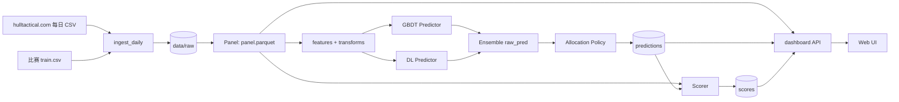

# Hull Tactical 重构与实盘监控方案 v1

状态：方案稿，未改任何代码  
日期：2026-11-21  
范围：`common/`、`gdbt/`、`dl/`、`dashboard/`、数据接入与服务器部署

---

## 0. 一页结论

1. 现在的 `common/` 是 Jane Street 仓库 `pipeline.py` 的半成品拷贝：保留了 `stocks / times / responders / COL_*` 等 Jane Street 数据形态，和 Hull 的"每天一行、只有一个市场"完全对不上。它目前不能运行，也不适合继续打补丁，应该按 Hull 的数据契约重写接口，只保留 `FullPipeline / PipelineCV / PipelineEnsemble` 的编排思想。
2. 推荐三层：`common`（数据、特征、切分、指标、分配、编排、追踪）+ `gdbt`（表格模型）+ `dl`（序列模型）。两个模型族共享同一份 panel、同一套 CV、同一个评分函数、同一个仓位策略；差异只在"模型 + 训练循环 + 在线更新方式"。
3. 数据源已核实：`https://www.hulltactical.com/kaggle-dataset-download/` 会 302 到按日期命名的 CSV（例如 `.../kaggle/20261120_data.csv`），96 列、1990-01-02 至 2026-11-20、每日更新、`target` 最后 3 行为 NA。它正好是比赛 `train.csv` 的超集：前 9048 行与 `date_id 0..9047` 对齐，之后多出 243 天（2025-12-04 至 2026-11-20），其中 240 天已有实现 target。这 240 天是天然、锁定、未参与比赛调参的 holdout，也是面板的"实盘记分牌"。
4. 一个重要口径发现：`train.csv` 里的 `market_forward_excess_returns`（target）并不等于 `forward_returns - risk_free_rate`。两者平均相差约 `-0.000311/日`（约 -7.8%/年），且这个差在 36 年里非常稳定。官方评分用的是 `position * (forward_returns - risk_free_rate)`，不是 `position * target`。训练目标和评分口径存在系统性偏差，必须在仓位层校准，或者直接用 `fwd - rf` 作为训练目标。
5. 建议顺序：先做"GBDT 复现 + 数据接入 + 最小面板"（约 1 周），再做 DL（约 1-2 周），最后集成和加固。不要一上来写 DL：这个数据集只有 7k-9k 个日样本，DL 的期望收益主要来自与 GBDT 的差异性和集成，而不是单模型碾压。

---

## 1. 现状审计

### 1.1 仓库结构

```
Hull_Tactical_solution/
├── data/train.csv                 9,048 行 × 98 列（比赛训练集）
├── data/test.csv                  10 行 × 99 列（比赛推理回放）
├── common/                        从 Jane Street 拷来的公共层（未完成）
│   ├── config.py                  只有 DATA_PATHS / ModelParameters
│   ├── pipeline.py                533 行，FullPipeline / PipelineEnsemble / PipelineCV
│   ├── metrics.py                 Hull 官方评分函数（单次调用版）
│   ├── transformers.py            PolarsTransformer（有 bug）
│   ├── tracker.py                 WandbTracker（写死 entity）
│   ├── utils.py                   shell / 建目录
│   └── setup_env.py               dotenv + wandb login
├── gdbt/
│   ├── model.py                   GBDTWrapper（enet + xgb + lgb）
│   ├── data_processor.py          DataProcessorGDBT
│   ├── experiments/five_fold_validation.py   早期实验脚本（缺上下文，不可直接跑）
│   └── notebooks/final_submission.ipynb      单 cell 的提交版脚本
├── kagglejanestreet-master/       参考仓库（完整可跑）
├── dl/                            空目录
├── models/                        空目录（models/gdbt、models/dl）
├── scripts/                       空目录
├── reports/                       空目录
└── requirements.txt               空文件
```

`git status` 显示 `src/`、`notebooks/`、`kaggle_evaluation/` 已被删除，`common/`、`gdbt/`、`kagglejanestreet-master/` 未跟踪。也就是说：这是一次进行中的重构，旧实现只存在于 git 历史里。

### 1.2 当前实现做了什么

旧版 `src/predict_function.py`（以及 notebook 里的同一份逻辑）是一个"逐行在线学习"的提交脚本：

1. 读 `train.csv`，重命名 target，过滤 `date_id >= 37`，只取最后 `max_train_rows = 800` 行。
2. 用缺失率 <= 0.5 过滤特征列，构造少量衍生特征（U1/U2、三个交互、若干 lag/rolling）。
3. 用中位数填补缺失，`StandardScaler` 标准化，训练 ElasticNet + XGBoost + LightGBM。
4. 每来一行测试数据：
   - 把上一行的 `lagged_market_forward_excess_returns` 当作已实现 target，追加进训练集；
   - 每 `retrain_freq = 1` 行，用最近 800 行重新 fit 三个模型；
   - 预测当前行，三个模型按 0.45 / 0.55 / 0.45 加权（注意：和是 1.45，没有归一化）；
   - 用 `V1` 和中位数决定信号乘数（600 或 400），`signal = clip(raw_pred * 600, 0, 2)`；
   - `allocation = signal / (vol * 1.2)`，再裁剪到 [0, 2]；
   - 与上一期仓位做 0.75 / 0.25 平滑，乘 `(1 - 0.00003)` 交易成本。
5. 输出 [0, 2] 的仓位，交给 Kaggle gateway。

这套逻辑的**设计意图**是"滚动 800 行 + 每日重训 + 波动率缩放 + 平滑"的在线适配。但仓库里这一版的 online 分支实际上永远不会触发（见 1.3 的说明），所以它实际是"启动时用最后 800 行训练一次"。新架构要把这个机制真正实现出来，而不是假设它已经存在。

### 1.3 当前代码的问题（必须修）

| 位置 | 问题 | 影响 | 处理 |
|---|---|---|---|
| `common/pipeline.py:30` | `from config import ...` 平铺导入 | 作为包导入时直接 ImportError | 改成 `from common.config import ...`，并用 `pyproject.toml` 可编辑安装 |
| `common/pipeline.py:123-131` | `COL_WEIGHT / COL_DATE / COL_TIME / COL_ID` 未定义 | NameError | 在 `common/config.py` 定义 Hull 的列常量；或从 Batch 里取 |
| `common/pipeline.py:138-139` | `self.responders`、`self.col_target` 在 `__init__` 里已被删掉 | AttributeError | 新接口不再需要 responders；target 由 Batch 携带 |
| `common/pipeline.py:167` | 调 `model.fit(train_set, val_set, verbose)` | `GBDTWrapper.fit` 只接受 `(X_train, y_train)` | 统一 Predictor 协议 |
| `common/pipeline.py:213` | 调 `model.update(X, y, weights, n_times)` | `GBDTWrapper.update()` 不接受参数 | 统一 `update(batch)` |
| `common/pipeline.py:514` | 调 `r2_weighted`，但 `common/metrics.py` 没有这个函数 | NameError | 用 Hull 官方评分 + 诊断指标替代 |
| `common/config.py` | 没有 `COL_DATE / COL_TARGET` 等常量 | `gdbt/data_processor.py:8` 导入即失败 | 补齐列常量 |
| `gdbt/model.py:7` | `from data_processor import ...` 平铺导入 | 从仓库根目录导入失败 | 改成 `from gdbt.data_processor import ...` |
| `gdbt/model.py:45` | `y_train.isna().any().any()`，但 y 是 numpy 数组 | AttributeError | 用 `np.isnan` 或让 Batch 保证无 NaN |
| `gdbt/model.py:29` | 集成权重 0.45 + 0.55 + 0.45 = 1.45 | 预测被放大 45%，再乘 600 后大量截断到 2 | 权重归一化，或交给集成层学习 |
| `common/transformers.py:59` | `df.with_columns(...)` 没有赋值 | `fit_transform` 实际没有填补缺失 | 赋值；并改成按列统计的向量化实现 |
| `common/transformers.py:60` | `fill_null(list_of_Series)` | polars 行为不确定/报错 | 用 `{col: median}` 字典逐列填补 |
| `gdbt/data_processor.py:104` | `fill_null(forward_fill()).fill_null(backward_fill())` | 用了未来值，实盘不可用 | 只允许 forward fill + 固定中位数；禁止 backward fill |
| `gdbt/data_processor.py:46-48` | 特征列表由当前训练窗口的缺失率决定 | 滚动窗口下特征集合会变，模型无法复用 | 特征列表冻结在配置/registry 里 |
| notebook / 旧 `predict_function.py` online 分支 | `previous_lagged = test` 存的是 `create_features` 之后的帧，已不含 `lagged_market_forward_excess_returns`，`if` 条件永远为 False → 在线重训是死代码；即使进入，target 被置为 `None` 后 `y_train.isna()` 也会抛错 | 实际只训练一次，滚动/在线机制没有生效 | 保留原始 lagged 列，或用已实现 `target` 的日期驱动更新；加单测验证第 2 行确实触发 `update` |
| `common/tracker.py` | wandb entity 写死 `QuasarHeart/hull_tactical` | 换环境不可用 | 改成配置项 |
| `common/tracker.py:5` | 从 `common.config` 导入 `WANDB_PROJECT, base_path`，但 config 里是 `WANDB_RPOJECT`（拼写错）且没有 `base_path` | tracker 导入即失败 | 修正常量名；`base_path` 用配置的日志目录 |
| `common/pipeline.py:28` | common 层 `import torch` | 只跑 GBDT 也要装 torch | 从 common 移除 torch 依赖；DL 类型放 `dl/` |
| `.gitignore` | 没有忽略 `data/raw/`、`data/lake/`、`models/` | 每日 CSV 和模型会进 git | 补上；只保留小样本 fixture |

### 1.4 数据事实（已实测）

比赛 `train.csv`：

- 9,048 行，`date_id 0..9047`，对应 1990-01-02 至 2025-12-03。
- 98 列 = `date_id` + 94 个特征（D/E/I/M/P/S/V 前缀）+ `forward_returns` + `risk_free_rate` + `market_forward_excess_returns`。
- target 均值 0.00005，标准差 0.01055，范围 [-0.0406, 0.0406]。
- 缺失集中在早期：1990-1994 年整体缺失 76.7%，1995-1999 年 15.8%，2000-2009 年 9.5%，2010-2019 年 2.2%，2020 年后 0.1%。E7 整体缺失 77%，M1/M13/M14 约 61%，V10 约 67%，S3 约 63%，M6 约 56%。
- `risk_free_rate` 均值 0.000107/日（约 2.7%/年），`forward_returns` 均值 0.00047/日。
- `target` 与 `forward_returns - risk_free_rate` 的差：均值 -0.0003112，标准差 0.0000715，且与 rf 基本无关。也就是说 `target ≈ fwd - rf - 0.000311`。

比赛 `test.csv`：

- 10 行，`date_id 8980..8989`，对应 2025-08-28 至 2025-09-11。
- 前 9 行 `is_scored = true`，最后一行 false。
- 这些行的特征值与 `train.csv` 同 date_id 完全一致（M11 有 7 位小数截断差异），本质是回放，不是真正的未来数据。
- 这说明：公开 LB 只覆盖 9 个交易日，噪声极大，不能用来做模型选择。

每日数据源（已实测 `2026-11-20` 文件）：

- 入口：`https://www.hulltactical.com/kaggle-dataset-download/`
- 302 到：`https://www.hulltactical.com/wp-content/uploads/kaggle/20261120_data.csv`
- 8,926,839 字节；9,291 行数据；96 列 = 空列名日期 + `target` + 94 个特征。
- 日期范围 1990-01-02 至 2026-11-20；无重复日期；只有 2001-09-11 后休市、2006 年末、2012-10 飓风 Sandy 等 3 处 >4 天的正常休市跳空。
- 最后 3 行（2026-11-18/19/20）`target = NA`；最后 240 个有 target 的日期是 2025-12-04 至 2026-11-17。
- 缺失值用字符串 `NA` 表示；列顺序按重要性排列，不是字母序；没有 `date_id`、`forward_returns`、`risk_free_rate`、`is_scored`。
- 与比赛 train 的重叠：前 9,048 行逐日对齐；M11 等少数列有 7 位小数级的舍入差异。其余列在 1e-9 内一致。
- 因此：**每日文件是比赛 train 的超集，应该作为实盘唯一真源；比赛 train 只用于拿 `fwd/rf` 和复现 LB。**

### 1.5 环境事实

- `requirements.txt` 是空文件；`kagglejanestreet-master/pyproject.toml` 用的是 poetry，且依赖版本较旧（polars 1.9、torch 2.4）。
- 本机 `kaggle` conda 环境（Python 3.13）有 polars/torch/sklearn/lightgbm，但**没有 xgboost**。
- 只有 `dlwpt` 环境（Python 3.12）同时具备 xgboost 3.3.0、lightgbm 4.6.0、torch 2.12.1+cpu、polars 1.44.2。
- 结论：不要复用 `kaggle` 环境跑本项目；新建独立环境（conda 或 `uv venv`），把 `dlwpt` 作为参照，锁定版本。DL 在这个数据量下 CPU 足够，服务器不需要 GPU。

---

## 2. 借鉴 kagglejanestreet 的什么、不借鉴什么

### 2.1 映射表

| Jane Street 仓库 | 新仓库 | 借鉴方式 |
|---|---|---|
| `janestreet/config.py` | `common/config.py` + `configs/*.yaml` | 保留 dataclass + 路径分环境的思想；改成 YAML + 环境变量 |
| `janestreet/data_processor.py` | `common/data.py` + `common/features.py` + `gdbt/features.py` + `dl/sequences.py` | 拆开：数据接入/共享特征/模型专属视图 |
| `janestreet/transformers.py` | `common/transforms.py` | 保留 fit/transform + 统计量持久化；修掉当前拷贝的 bug |
| `janestreet/metrics.py` | `common/metrics.py` | 不照搬 weighted R2；换成 Hull 官方评分 + IC/R2/Sharpe 诊断 |
| `janestreet/pipeline.py` | `common/pipeline.py` | 保留 FullPipeline / PipelineCV / PipelineEnsemble 三层；重写张量契约 |
| `janestreet/models/nn.py` | `dl/model.py` + `dl/trainer.py` | 借鉴"按日组织序列 + 多辅助目标 + 在线一步更新 + 种子集成"；不照搬 968 步 GRU |
| `janestreet/tracker.py` | `common/tracker.py` | 保留 wandb 记录 + feature list artifact；entity/project 改成配置 |
| `scripts/python/run_cv.py` | `scripts/run_cv.py` | 薄入口：读配置 -> 跑 CV -> 存 artifact |
| `scripts/python/run_full_2.py` | `scripts/run_full.py` | 薄入口：全量训练 + 保存最终模型 |
| `scripts/python/run_ensemble.py` | `scripts/run_ensemble.py` | 薄入口：加载多个 run -> 集成 -> 评分 |
| `scripts/python/run_test_gap.py` | `scripts/run_gap_test.py` | 保留"训练到最后一天，跳过 gap，再测一段"的思想；Hull 用 2025-12-04 起的 240 天 |
| `janestreet/kaggle.py` | `competition/gateway.py`（归档） | 只用于复现比赛提交，不进入日常管线 |

### 2.2 不能照搬的地方

- **不要照搬 `n_times` / `hidden` / `symbols` 的张量契约**。Jane Street 的一天是 `symbols × 968 个 time_id`，Hull 的一天只有一行。硬套会把 `PipelineCV` 写成一堆 reshape，且无法表达"按日滚动"。
- **不要照搬 100GB RAM / 12GB GPU 的假设**。Hull 全量不到 1 万行 × 95 列，CPU 几秒到几分钟就能训练。
- **不要把 weighted R2 当模型选择指标**。Hull 的排行榜是波动率调整后的 Sharpe，R2 只能作为诊断。
- **不要照搬 responder_6..10 的构造**。Jane Street 的 multi-horizon responder 是同一潜变量的不同期限平滑；Hull 可以借用"多期限 forward excess return"的思想，但公式要重写。
- **不要把 Kaggle gateway 放进 common**。gateway 是比赛推理协议，和实盘面板无关；放 `competition/` 归档。
- **不要照搬"每天一个 batch = 一天"的训练方式**。Jane Street 一个 batch 是一天的横截面；Hull 没有横截面，应该是一个 batch = 若干条历史序列。

---

## 3. 目标架构

### 3.1 设计原则

1. **一份数据契约**：所有模型都从同一个 `Panel` 取数，日期、target、特征名、缺失规则只有一套。
2. **一份验证协议**：折的划分、purge、锁定 holdout、评分函数只在 `common` 实现一次。
3. **一份仓位策略**：`raw_pred -> allocation` 是共享组件，GBDT 和 DL 用同一套；否则两个模型的分数不可比。
4. **模型只负责"预测收益"**：训练循环、在线更新、序列化是模型自己的事；数据、指标、仓位、编排是 common 的事。
5. **先可复现，再复杂**：每个 run 有 manifest、数据哈希、git sha、配置哈希；没有这些，DL 的调参结果不可信。
6. **薄脚本**：`scripts/*.py` 只做参数解析和调用，不写业务逻辑。

### 3.2 目录结构

```
Hull_Tactical_solution/
├── pyproject.toml                  # 可编辑安装；packages = common, gdbt, dl, dashboard
├── configs/
│   ├── base.yaml                   # 路径、数据源、日期范围、seed、日志
│   ├── gdbt/default.yaml
│   ├── dl/gru.yaml
│   └── ensemble/default.yaml
├── common/
│   ├── __init__.py
│   ├── config.py                   # YAML -> dataclass；COL_* 常量；路径
│   ├── schema.py                   # 列名/类型/校验规则
│   ├── data.py                     # 每日 CSV + 比赛 CSV -> Panel（polars）
│   ├── features.py                 # 共享、因果的特征工程
│   ├── transforms.py               # 缺失/标准化/裁剪；fit on train；持久化
│   ├── splits.py                   # walk-forward + purge + 锁定 holdout
│   ├── metrics.py                  # 官方评分 + 代理评分 + IC/R2/Sharpe/回撤/换手
│   ├── allocation.py               # Predictor 输出 -> [0,2] 仓位
│   ├── backtest.py                 # 净值/回撤/滚动指标
│   ├── pipeline.py                 # FullPipeline / PipelineCV / PipelineEnsemble
│   ├── model.py                    # Batch / Predictor 协议
│   ├── tracker.py                  # wandb / 本地 JSON
│   ├── registry.py                 # run 目录、manifest、active 指针
│   └── utils.py
├── gdbt/
│   ├── __init__.py
│   ├── features.py                 # 表格特征选择/交互
│   ├── model.py                    # SklearnEnsemble（enet/xgb/lgb）
│   ├── search.py                   # optuna
│   └── config.py
├── dl/
│   ├── __init__.py
│   ├── sequences.py                # 滑窗 Dataset
│   ├── model.py                    # GRU / TCN / Transformer + 多头
│   ├── loss.py                     # weighted MSE / Sharpe loss
│   ├── trainer.py                  # 训练、早停、预测、在线更新
│   └── config.py
├── dashboard/
│   ├── __init__.py
│   ├── app.py                      # FastAPI
│   ├── queries.py                  # DuckDB SQL
│   ├── materialize.py              # 每日汇总
│   ├── static/                     # index.html / app.js / echarts.min.js / style.css
│   └── templates/
├── competition/                    # 归档：gateway、submission、LB 复现
├── scripts/
│   ├── ingest_daily.py
│   ├── daily_job.py                # 摄入 -> 预测 -> 评分 -> 刷新
│   ├── predict_daily.py
│   ├── score_daily.py
│   ├── run_cv.py
│   ├── run_full.py
│   ├── run_ensemble.py
│   ├── run_gap_test.py
│   └── backfill.py
├── deploy/
│   ├── Dockerfile
│   ├── docker-compose.yml
│   ├── nginx.conf
│   ├── hull-api.service
│   ├── hull-daily.service
│   ├── hull-daily.timer
│   └── backup.sh
├── tests/
├── data/                           # gitignore
│   ├── raw/hull/YYYYMMDD_data.csv
│   ├── raw/competition/train.csv
│   ├── lake/panel.parquet
│   └── lake/monitor.duckdb
├── models/                         # gitignore
├── reports/                        # gitignore（保留 summary.md）
└── docs/
    ├── plan/architecture_v1.md
    ├── data_contract.md
    └── experiments.md
```

### 3.3 依赖方向

```
configs -> common <- gdbt
                    <- dl
common  <- dashboard
scripts -> common/gdbt/dl/dashboard
```

规则：

- `common` 不 import `gdbt` / `dl`。
- `gdbt` 和 `dl` 不互相 import。
- `dashboard` 只读 `data/` 和 `models/`，不 import 训练代码（避免把 torch 带进 API 镜像）。
- `scripts` 是唯一允许同时 import 两个模型族的地方。

### 3.4 共享 vs 专属矩阵

| 能力 | common | gdbt | dl |
|---|---|---|---|
| 每日 CSV 下载/校验 | 共享 | | |
| 比赛 CSV 读取/口径 | 共享 | | |
| Panel / date_id / 排序 | 共享 | | |
| 基础特征工程 | 共享 | | |
| 模型专属特征视图 | 共享接口 | 表格选择/交互 | 序列滑窗 |
| 缺失/标准化/裁剪 | 共享 | | |
| CV 折 / purge / 锁定 holdout | 共享 | | |
| 官方评分 / 诊断指标 | 共享 | | |
| 仓位策略 / 平滑 / 成本 | 共享 | | |
| 回测 / 净值 / 回撤 | 共享 | | |
| Pipeline 编排 | 共享 | | |
| 模型与训练循环 | | sklearn | torch |
| 在线更新实现 | 协议 | 滚动 refit | 梯度一步 |
| 超参搜索 | | optuna | optuna |
| 集成权重 | 共享 | | |
| 实验追踪 / registry | 共享 | | |
| Dashboard | 独立子包 | | |

### 3.5 核心接口

```python
# common/model.py
from dataclasses import dataclass
from pathlib import Path
from typing import Protocol
import numpy as np

@dataclass
class Batch:
    X: np.ndarray            # GBDT: (N, F)；DL: (N, L, F)
    y: np.ndarray            # (N,)  metric target = fwd_ret - rf_rate
    aux: np.ndarray | None   # (N, H) 多期限辅助目标
    w: np.ndarray            # (N,)  样本权重
    dates: np.ndarray        # (N,)  np.datetime64[D]
    features: list[str]

class Predictor(Protocol):
    name: str
    lookback: int            # GBDT=1；DL=L
    def fit(self, train: Batch, valid: Batch | None) -> None: ...
    def predict(self, batch: Batch) -> np.ndarray: ...   # raw excess return forecast
    def update(self, batch: Batch) -> None: ...          # 可选：在线一步
    def save(self, path: Path) -> None: ...
    @classmethod
    def load(cls, path: Path) -> "Predictor": ...
```

```python
# common/pipeline.py（编排，不含模型细节）
class FullPipeline:
    def __init__(self, predictor, transforms, policy, run_dir): ...
    def fit(self, panel, train_dates, tune_dates): ...
    def predict_dates(self, panel, dates) -> pl.DataFrame: ...
    # 内部：for d in dates: build_batch(<=d) -> predict -> policy -> 可选 update(d-1)

class PipelineCV:
    def fit(self, panel, folds) -> CVResult: ...
    # 每个 fold: clone -> fit(train, tune) -> predict_dates(test) -> score
    # 返回 OOF predictions、每折分数、平均分、最差折、IC

class PipelineEnsemble:
    def fit(self, oof_by_model, tune_dates) -> EnsembleResult: ...
    # 拟合非负权重；对 raw_pred 加权，再统一走 policy
```

关键点：

- **online 循环放在 `FullPipeline.predict_dates` 里**，不在每个脚本里重复。两个模型族的行为一致：预测 d 时只能用 <= d 的信息；更新只能用已经实现 target 的 d-1（或 d-2，按数据滞后）。
- **仓位策略在 `common/allocation.py`**，作为 `FullPipeline` 的组件，按 fold 拟合，不能在全样本上拟合。
- **集成在 raw prediction 层做**，不是对 allocation 做平均；因为 allocation 是非线性的。

### 3.6 数据流



---

## 4. 数据层

### 4.1 两个数据源

| 源 | 用途 | 更新 | 是否可变 |
|---|---|---|---|
| 每日 CSV（hulltactical.com） | 实盘特征 + 最新 target | 每日 | 可能修订最近几行；只追加，不覆盖 raw |
| 比赛 `train.csv` | 历史 `fwd_ret` / `rf_rate` / LB 复现 | 冻结 | 不变 |
| 比赛 `test.csv` | 复现 9 天评分、测试官方评分函数 | 冻结 | 不变 |

### 4.2 每日源的事实与接入细节

- 入口 URL 是 302：`/kaggle-dataset-download/` -> `/wp-content/uploads/kaggle/YYYYMMDD_data.csv`。
- 建议直接用 `requests.get(..., allow_redirects=True)`，从 `response.url` 解析文件名日期；失败时按 `今天、昨天、...` 最多回退 5 天构造 URL。
- 请求头用普通浏览器 UA，超时 30-60 秒，失败重试 3 次（指数退避）；每天只下载 1-2 次，不要轮询。
- 原始文件保存为 `data/raw/hull/YYYYMMDD_data.csv`，计算 sha256，写 `ingest_log`；已存在且 sha256 相同则跳过。
- 用 `polars.read_csv(..., null_values=["NA"], try_parse_dates=False)`；第一列空列名重命名为 `date`；日期用 `pl.Date`。
- 列顺序不可依赖：按名字选 94 个特征；缺失列/多余列直接报错。
- `target` 最后 3 行是 NA，不要当 0；`is_scored` 不在文件里，实盘把"有 target"视为已实现。

### 4.3 口径问题：target 与官方评分

官方评分函数（`common/metrics.py` 要实现的）：

```
strategy_returns_t = rf_t * (1 - pos_t) + pos_t * fwd_t
excess_t          = strategy_returns_t - rf_t = pos_t * (fwd_t - rf_t)
market_excess_t   = fwd_t - rf_t
sharpe            = geometric_mean(excess) / std(strategy_returns) * sqrt(252)
vol_penalty       = 1 + max(0, strategy_vol / market_vol - 1.2)
return_penalty    = 1 + max(0, (market_mean_excess - strategy_mean_excess) * 100 * 252)^2 / 100
score             = sharpe / (vol_penalty * return_penalty)
```

而 `train.csv` 的 target 是 `market_forward_excess_returns`，实测：

```
target ≈ fwd_ret - rf_rate - 0.0003112      (均值差，sd 7.1e-5)
```

这意味着：

1. 用 target 训练出来的模型，预测的是"扣掉 3.1bp/日"的收益；官方评分奖励的是 `fwd - rf`，平均高 3.1bp/日。模型会系统性地低估应该持有的仓位。
2. 官方评分的 `strategy_returns` 用的是 `fwd` 和 `rf`，不是 target；只拿 target 无法精确复现分数。
3. 现有代码用 `raw_pred * 600` 放大信号，某种程度上掩盖了这个偏差，但不可控。

建议：

- 训练目标用 `y_metric = fwd_ret - rf_rate`（比赛期间有精确值）；实盘新日期用 `y_metric = target + C`，`C` 在重叠区间估计（当前 0.0003112），每月重估。
- Panel 同时保留 `target`（兼容/回测）和 `target_metric`（训练/评分）。
- 实盘评分优先用 `fwd = target + C + rf` 重建；`rf` 从 FRED `DTB3` 取（或先用 rf=0 的代理分，并在面板上标注"代理"）。
- 所有分数都同时显示"精确"（有 fwd/rf）和"代理"（只有 target）两个版本，避免误读。

### 4.4 存储分层

| 层 | 路径 | 内容 | 写入方 |
|---|---|---|---|
| raw | `data/raw/hull/` | 每日原始 CSV，不可变 | ingest |
| raw | `data/raw/competition/` | 比赛 train/test，不可变 | 一次性拷贝 |
| silver | `data/lake/panel.parquet` | 标准化后的宽表，一行一天 | ingest（upsert） |
| gold | `data/lake/features.parquet` | 可选：特征缓存 | 训练任务 |
| monitor | `data/lake/monitor.duckdb` | predictions / scores / runs / ingest_log / alerts | daily job / 训练脚本 |

Panel 的列：

```
date: Date (unique, ascending)
date_id: Int32            # 每日文件的行号；与比赛 train 的 date_id 对齐
target: Float64           # market_forward_excess_returns，允许尾部 NA
target_metric: Float64    # fwd_ret - rf_rate，或 target + C
fwd_ret: Float64 | null   # 仅比赛期间
rf_rate: Float64 | null   # 仅比赛期间；实盘可接 FRED
I1..V13: Float64          # 94 列，固定顺序
ingested_at: Datetime
source_file: String
```

### 4.5 Schema 与校验

`common/schema.py` 定义：

- `FEATURES`: 94 个名字的固定列表（从比赛 train 的列名生成一次，写入代码/配置，不动态推断）。
- `DTYPES`: 全部 Float64（D1..D9 是 0/1，但保留 Float64 便于统一处理）。
- `validate_panel(df)`：
  - 列名集合完全匹配；
  - `date` 唯一、升序；
  - 行数 >= 9000（实盘），且比上次只多 0/1 行（允许修订）；
  - `target` 的 NA 只允许出现在最后 3 行（允许 2-4 的浮动，超出告警）；
  - 最近 250 行每个特征的缺失率 < 5%（超出告警，不自动删列）；
  - 特征值不在 `[train_mean ± 10*train_std]` 的比例 < 1%（超出告警）；
  - 文件 sha256 记录，重复文件跳过。

### 4.6 摄入流程与幂等

```
1. 解析最新 URL（302 Location）-> 文件日期
2. 若日期 <= last_ingested_date：退出 0
3. 下载到 data/raw/hull/{date}_data.csv
4. 校验 schema / 行数 / 日期
5. 读入 polars，重命名、切列、cast
6. upsert panel.parquet：按 date 去重，保留最新版本；写 revision 记录
7. 写 ingest_log（url, sha256, rows, status, error）
8. 若校验失败：保留旧 panel，告警，退出非 0
```

幂等键：`date`。所有写操作都是 upsert；重复跑同一天不会产生重复行。`ingest_log` 记录每次尝试，便于排查。

### 4.7 点时正确性（point-in-time）

- 预测日期 d 的仓位，只能使用 `<= d` 的特征；target 只能使用 `<= d-1` 已实现的（因为 target_t 需要 t+1 的收益）。
- 特征工程中禁止：`backward_fill`、全样本 `mean/std`、全样本分位数、用 target 的当前值做 rolling、用未来日期的数据做交互。
- 训练/验证切分必须 purge 掉边界上的重叠 target：单日 target purge 1-2 天；多期限辅助 target purge 最长 horizon（例如 60 天）。
- 所有 transform 的统计量在训练段 fit，验证/测试段只 transform；禁止在验证段 refit（除非明确是"在线更新"协议，并且记录在案）。

---

## 5. 特征与预处理

### 5.1 共享特征（common/features.py）

原则：只保留"在 t 日收盘后可知"的特征；所有 rolling/shift 都按日期升序，先 shift 再 rolling（避免包含当日 target）。

建议的共享特征组：

1. **原始 94 列**：不做任何跨样本变换，只做缺失填补和标准化。
2. **利率/曲线类**：I 组的差分、比值、滚动均值（I1..I9 的具体含义未知，先用通用的 `I2-I1`、`I9-I1`、`I2/I1`）。
3. **市场状态**：`V1` 的 expanding percentile（只用过去）、`V1` 的 5/20/60 日均值、`S1` 的 20 日动量、`M11` 的 60 日均值。
4. **已实现波动**：target 的 5/20/60 日 rolling std，**shift(1)**；这是仓位层最有效的输入之一。
5. **动量/趋势**：target 的 5/20/60/252 日累计收益，shift(1)；`I2_MA66` 保留，但确保 rolling 只含过去。
6. **交互**：`V1*S1`、`M11*V1`、`I9*S1`（保留现有三个，逐个做消融）。
7. **日历**：星期、月份、月末/月初、季度末；先用简单的 one-hot/整数，测试是否有增益。
8. **缺失指示**：对训练窗口缺失率 > 5% 的特征，加 `{col}_isna` 0/1；不要对全部 94 列都加。

注意：`target_roll_std_5` 这类"用 target 的 rolling"必须 shift(1) 后才能作为特征；现有代码把它放在 `additional_features` 里又从模型特征列表中排除，等于没用，建议直接删掉或正确 shift 后加入。

### 5.2 现有特征的处置

| 特征 | 处置 |
|---|---|
| U1 = I2 - I1 | 保留 |
| U2 = M11 / mean(I2,I9,I7) | 保留；注意除零，加 eps |
| I2_MA66 | 保留；确认 rolling 窗口是过去 66 天，不含未来 |
| V1_S1, M11_V1, I9_S1 | 保留；逐个消融 |
| S1_lag1, P1_lag1, I9_lag1 | 保留；这些是 shift(1)，安全 |
| V1_roll_mean_5 | 保留；rolling 含当日，安全（当日 V1 已知） |
| target_roll_std_5 | 删除或 shift(1) 后使用；当前版本有泄漏风险 |
| I 组 forward_fill + backward_fill | 去掉 backward_fill；只 forward_fill + 训练中位数 |
| 缺失率 > 0.5 动态删列 | 改为冻结的特征列表；高缺失列在配置里显式列出 |

### 5.3 缺失值策略

- 训练段：对每个特征计算中位数（只用训练段），保存到 `transforms.json`。
- 推理段：用保存的中位数填补；不做 backward fill。
- I 组：允许 forward fill（最多 5 天），然后中位数；forward fill 的状态要随模型一起保存，实盘逐日更新。
- 对高缺失特征（E7、M1、M13、M14、V10、S3、M6）：
  - 若训练段缺失率 > 40%，默认丢弃；
  - 若保留，加缺失指示，并在报告中标注。
- 禁止把 NA 当 0（除了树模型可以接受，但统计量会偏）。

### 5.4 标准化与冻结

- 标准化：`(x - mean_train) / std_train`，`std_train < 1e-8` 时置 1。
- 裁剪：`clip(-5, 5)`（标准化后），防止极端值；裁剪阈值写入 transform 配置。
- 统计量只在训练段 fit；每个 fold 重新 fit；最终模型用全量训练段 fit。
- `common/transforms.py` 要修掉当前 `PolarsTransformer` 的三个问题：`fit_transform` 没赋值、list-of-Series 填补、`transform` 的 `refit` 语义不清。
- 建议直接用 polars 的 `with_columns` + 每列一个 `pl.col(c).fill_null(m).clip(lo, hi)`，统计量存 `dict[str, float]`。

### 5.5 DL 序列视图（dl/sequences.py）

- 输入：`(N, L, F)`，L 为回看天数（20/60/120/252 做消融），F 为特征数。
- 序列末尾是预测日 d；标签是 d 的 `target_metric`（即 d -> d+1 的收益）。
- 缺失：先按 5.3 填补，再标准化；可选加 `isna` 通道。
- 序列构建：
  - 对每个有效日期 d（d >= start + L），取 `[d-L+1, d]` 的 F 维特征；
  - 标签 `y[d]`；辅助标签 `y5/y20/y60` 需要未来数据，最后 60 天没有完整标签，训练时 mask 掉；
  - 日期数组用于切分和在线更新，不能打乱日期顺序做验证。
- Dataset 返回 `(X, y, aux, w, date)`；`DataLoader` 可以 shuffle 训练序列（每条序列自包含），验证按日期顺序。
- 归一化在 Dataset 之外做（用 `common/transforms.py` 的统计量），避免每个 batch 重新算。

### 5.6 GBDT 表格视图（gdbt/features.py）

- 直接用 `(N, F)` 的表格；`L=1`。
- 额外做：
  - 特征选择：按训练段 gain/importance 排序，保留 Top-K（K=60/80/94 做消融），但**特征列表写入配置**，不在每次 fit 时变。
  - 相关性剪枝：对 ElasticNet，去掉 |corr| > 0.98 的冗余列（保留重要性高的）。
  - 分位数裁剪：1%/99% 在训练段计算，写入 transform。
- 不做 target encoding、不做跨样本统计（没有类别变量，没必要）。

---

## 6. 验证与指标

### 6.1 折的划分

建议 6 折 walk-forward，每折 250 个交易日验证，前面留 100 天 tune，训练段 expanding：

| Fold | Train | Tune | Test |
|---|---|---|---|
| 1 | 1995-01-01 .. 2013-12-31 | 2014 | 2015 |
| 2 | .. 2015-12-31 | 2016 | 2017 |
| 3 | .. 2017-12-31 | 2018 | 2019 |
| 4 | .. 2019-12-31 | 2020 | 2021 |
| 5 | .. 2021-12-31 | 2022 | 2023 |
| 6 | .. 2023-12-31 | 2024 | 2025-01 .. 2025-12-03 |
| 锁定 | .. 2025-12-03 | — | 2025-12-04 .. 2026-11-17（240 天） |

说明：

- 1990-1994 缺失 76.7%，默认从 1995 开始；做一次"2000 起"的敏感性分析。
- Fold 4 覆盖 2020 COVID，Fold 5 覆盖 2022 加息，Fold 6 覆盖比赛期；regime 覆盖面比随机 KFold 好。
- 锁定 holdout 只用于最终报告和面板展示，不参与调参、不参与早停、不参与特征选择。用一次，写进 `reports/final.md`。
- 如果觉得 6 折太多，最少保留 4 折（2015/2018/2021/2024）+ 锁定 holdout。

### 6.2 purge / embargo

- 单日 target：train 的最后 2 天 purge（target_t 需要 t+1）。
- 多期限辅助 target：train 的最后 `max_horizon` 天 purge（例如 60 天），或把这些天的 aux label mask 掉。
- DL 序列：验证段第一天的序列会包含训练段最后 L-1 天的特征，这是允许的（特征是过去信息）；但训练段的 target 不能覆盖验证段的第一天，所以 purge 仍然按 target 做。
- gap test：训练到 `T`，跳过 `G` 天（例如 200 天），再测接下来的 250 天；模拟"部署后一段时间没有重训"。锁定 holdout 是 `G=0` 的版本；再做一个 `G=200` 的版本作为稳健性检查。
- 实现：`WalkForwardSplit(gap=2, aux_horizon=60)`，返回 `train_dates / tune_dates / test_dates`，内部自动扣掉边界。

### 6.3 指标实现（common/metrics.py）

必实现：

```python
def official_score(allocation, fwd_ret, rf_rate) -> ScoreReport
def proxy_score(allocation, target_metric, rf_rate=None) -> ScoreReport
def r2_weighted(y, pred, w=None) -> float
def ic_spearman(pred, y) -> float
def sharpe(returns) -> float
def max_drawdown(equity) -> float
def turnover(allocation) -> float
def bootstrap_score(..., block=20, n=1000) -> tuple[float, float, float]
```

`ScoreReport` 至少包含：`score, sharpe, strategy_vol, market_vol, vol_penalty, return_penalty, strategy_mean_excess, market_mean_excess, n_days`。面板上要展示惩罚项，不能只展示最终分数。

测试：用 `train.csv` 的 date_id 8980..8988（9 个 scored 日）和任意一组 allocation，调用官方 `score()` 与向量化实现，误差 < 1e-9。

### 6.4 模型选择标准

不要只看平均分。建议同时报告：

- 每折 score、平均 score、最差折 score；
- OOF IC（Spearman）、方向准确率；
- 仓位均值/标准差、换手、最大回撤；
- 与现有 GBDT 预测的相关性；
- score 的 block bootstrap 95% 置信区间。

选择规则（建议）：

1. 先排除最差折比基线差 > 0.02 的模型；
2. 在剩下的模型里，选平均分最高且 IC 稳定（每折 IC > 0）的；
3. 如果两个模型分数接近（< 0.005），选更简单、换手更低、与现有模型相关性更低的；
4. 锁定 holdout 只做最终确认，不做反向选择。

### 6.5 统计显著性

- 240 天、日波动 1% 的情况下，Sharpe 的标准误约 `sqrt(252/240) ≈ 1.02`；0.3 的 Sharpe 完全可能是噪声。
- 用 block bootstrap（block=20 天）对整条评分链路重采样，报告 95% CI。
- 不要用 9 天的公开 LB 做任何选择；它的标准误更大。
- 如果 DL 相对 GBDT 的提升 < 0.005 且 CI 跨 0，按"没有提升"处理。

---

## 7. 传统 ML 管线（gdbt/）

### 7.1 模型

- ElasticNet：线性基线，强正则；用于诊断特征方向。
- XGBoost：`reg:squarederror`，深度 4-6（不是现在的 10），学习率 0.03-0.05，早停。
- LightGBM：`regression`，叶子 31-63，最小数据 50+，feature_fraction 0.7。
- 可选 CatBoost：如果安装方便，作为第三个树模型；否则跳过。
- 不做 stacking 的复杂 meta-learner；集成层只做非负加权。

### 7.2 训练与在线更新

- 训练窗口：expanding 到 fold 起点，或固定最近 10 年；两者做消融。当前代码的"最近 800 行"是一个很强的 recency 先验，保留为 `window=800` 的候选。
- 样本权重：指数衰减，半衰期 3 年（可调）；再加"每年等权"的平衡权重，避免 1990s 样本过多。
- 目标：`target_metric = fwd - rf`；如果只用 target，加一个常数 `C` 做偏置校正。
- 在线更新：
  - 方案 A（复现当前）：每来一天，用最近 `window` 行重新 fit 三个模型；数据量小，成本可接受。
  - 方案 B：每周全量 refit，平时只更新 scaler 的 running stats；更稳定。
  - 方案 C：XGBoost 用 `xgb_model` 增量训练（warm start），LightGBM 用 `init_model`；ElasticNet 用 SGD 增量。实现复杂，先不做。
  - 建议先做 A，作为基线；再用 B 做对比。
- 预测：三个模型 raw_pred 先按验证段拟合的权重加权（或等权），再进入共享 policy。

### 7.3 超参搜索

- Optuna，50-100 trials，目标 = 平均 fold score（不是 MSE）。
- 搜索空间：树的深度/叶子/学习率/正则、ElasticNet 的 alpha/l1_ratio、窗口长度、样本权重半衰期。
- 每个 trial 用 2-3 折快速筛选，最优的 5 个再做全折。
- 搜索过程写 wandb/JSON，记录 trial 的 score 和参数。

### 7.4 产物

```
models/{run_id}/
  config.json
  features.json
  transforms.json
  model.joblib
  policy.json
  cv_scores.json
  oof_predictions.parquet
  manifest.json
```

### 7.5 与 common 的接口

`gbdt/model.py` 实现 `Predictor`：

```python
class SklearnEnsemble:
    name = "gdbt"
    lookback = 1
    def fit(self, train: Batch, valid: Batch | None): ...
    def predict(self, batch: Batch) -> np.ndarray: ...
    def update(self, batch: Batch): ...   # 追加到训练窗口，按策略 refit
    def save(self, path): ...
```

不再有 `n_times`、`hidden`、`stocks`；这些是 Jane Street 的概念。

---

## 8. 深度学习管线（dl/）

### 8.1 为什么不能照搬 Jane Street 的 NN

| 维度 | Jane Street | Hull |
|---|---|---|
| 样本量 | 数千万行（symbols × time_ids） | 7k-9k 行（每天一行） |
| 一天的结构 | 39 symbols × 968 time_ids | 1 行 |
| 序列 | 一天内的 968 步 | 跨天的 L 天回看 |
| 目标 | responder_6 + 4 个辅助 responder | 1 个市场超额收益 + 多期限辅助 |
| 指标 | weighted R2 | 波动率调整 Sharpe |
| 计算 | 100GB RAM / 12GB GPU | CPU 足够 |

所以：序列维度要从"一天内的 968 步"换成"跨天的 L 天回看"，输入是 `(N, L, F)` 的日频序列，而不是 `(symbols, 968, F)` 的日内序列。这是最大的结构差异，不能照抄。

### 8.2 序列数据集

- L：20 / 60 / 120 / 252，默认 60。
- 特征：5.1 的共享特征 + 5.5 的标准化；可选加一阶差分 `x_t - x_{t-1}` 作为额外通道。
- 标签：
  - 主头：`y1 = target_metric[d]`（d -> d+1）。
  - 辅助头：`y5, y20, y60` = 未来 5/20/60 天累计 `target_metric`；
  - 辅助头：`vol20` = 未来 20 天 `target_metric` 的已实现波动（可选）。
- 最后 60 天没有完整辅助标签：训练时 mask，不能填 0。
- 样本权重：与 GBDT 相同（recency + 年度平衡），保证两个模型族可比。
- 训练窗口：默认 1995 至今 + recency 权重；同时做"最近 10 年"和"最近 800 天"的消融，确认 DL 不是靠更多历史取胜。

### 8.3 架构

基线（按顺序试，不要一次上最复杂的）：

1. **GRU-1**：`GRU(input=F, hidden=128, layers=1, batch_first=True)` -> 取最后一步 -> LayerNorm -> Dropout(0.2) -> Linear(64) -> GELU -> Linear(1)。
2. **GRU-2**：两层 GRU(256, 128) + 残差/投影；dropout 0.2-0.3。
3. **TCN**：4 个 dilated conv block（dilation 1/2/4/8），kernel 3，channels 64-128；对长序列更稳，训练更快。
4. **Transformer**：2 层、4 头、d_model=128、learnable positional encoding；样本少时容易过拟合，放最后。
5. **MLP on flattened window**：`L*F -> 256 -> 1`，作为"没有时序结构"的对照；如果它和 GRU 差不多，说明时序建模没带来信息。

输出头：

```
shared encoder -> h_t (B, H)
  -> head_main: Linear(H,1)                  # 1 日
  -> head_5:    Linear(H,1)                  # 5 日
  -> head_20:   Linear(H,1)                  # 20 日
  -> head_60:   Linear(H,1)                  # 60 日
  -> head_vol:  Linear(H,1) + softplus       # 20 日波动
```

推理时只用 `head_main`；也可以拟合一个 4 头的线性组合（在 tune 段），但先不要。

### 8.4 辅助目标

借鉴 Jane Street 的"多 responder"思想，但换成 Hull 可解释的期限结构：

```
y1[d]  = target_metric[d]
y5[d]  = sum(target_metric[d : d+5])
y20[d] = sum(target_metric[d : d+20])
y60[d] = sum(target_metric[d : d+60])
```

注意：

- 这些是重叠的累计收益，标签之间高度相关；辅助头的作用是正则化/多尺度，不是独立信息。
- 训练时对辅助头做 mask（最后 60 天）；推理时不需要辅助标签。
- 辅助头的 loss 权重：主头 1.0，y5 0.5，y20 0.3，y60 0.2；做消融。
- 如果辅助头没有提升，果断去掉；不要为了"像 Jane Street"而保留。

### 8.5 损失

推荐主损失：

```
sigma_t = rolling_std(target_metric, 20).shift(1).clip(min=1e-4)
z_t     = y_t / sigma_t
L_main  = weighted_mse(pred_main, z_t, w_t)
L_aux   = sum_h w_h * weighted_mse(pred_h, z_h, w_t)
L       = L_main + 0.5 * L_aux
```

可选（消融，最后试）：

```
pos = clip(a + b * pred_main * sigma_t, 0, 2)
L_sharpe = -mean(pos * y_t) / (std(pos * y_t) + 1e-6)
L = L_main + 0.1 * L_sharpe
```

注意：Sharpe loss 噪声大，容易不稳定；只作为微调阶段，学习率调小，并监控仓位分布。

### 8.6 训练协议

- 优化器：AdamW，lr 1e-3，weight decay 1e-4（GRU/TCN）；Transformer 用 3e-4。
- batch：64 条序列（不是 1 天）；shuffle 训练序列。
- epochs：最多 200；早停 patience 20；监控验证段的 IC 或 score（不是训练 loss）。
- 梯度裁剪：1.0；学习率调度：cosine 或 ReduceLROnPlateau。
- dropout：0.2-0.3；LayerNorm；权重初始化默认。
- 早停指标：验证段 `official_score`（用 tune 段拟合的 policy）或 IC；两者都记录，主指标选 IC 更稳（policy 只有 2 个参数，过拟合风险低）。
- 训练完保存 best state_dict + 训练配置 + 特征列表 + transform 统计量。

### 8.7 在线更新

- 每来一个已实现 target 的日期 d：
  - 取最近 W=252 条序列（或最近 1 年）；
  - 前向 + 反向一次，lr = 1e-4（比训练小 10 倍）；
  - 只用主头 loss（Jane Street 也是只用 responder_6 更新）；
  - 梯度裁剪 1.0；若 |y| > 5*sigma，跳过这次更新（异常值保护）。
- 更新频率：每日一次；如果某天没有新 target，跳过。
- 记录：更新前后在最近 20 天的预测变化、loss、仓位变化；异常时告警。
- 每周做一次全量 fine-tune（可选），每月从头重训（可选）；先只用每日一步更新，保持简单。

### 8.8 集成

- 每个架构/seed 训练 3-5 个；
- 先在同一架构内平均 raw_pred（seed ensemble）；
- 再在架构间平均（GRU-1 + GRU-2 + TCN）；
- 最后与 GBDT 做跨族集成（第 9 节）；
- 集成权重在 OOF 上拟合，不要在 test 上拟合。

### 8.9 预期与 go/no-go

诚实的预期：

- 9k 行、94 个噪声特征，DL 单模型很难显著超过 GBDT；Jane Street 的 +0.008 来自数千万行和日内结构，不能直接类比。
- DL 的价值主要在：与 GBDT 的低相关性、对非线性 regime 的建模、多期限辅助目标带来的正则化。
- 如果 DL 的 CV 平均分比 GBDT 低 0.01 以内，且相关性 < 0.9，集成可能仍有 +0.003-0.008；如果低太多，放弃。

go/no-go 标准：

1. CV 平均 score >= GBDT - 0.01；
2. 最差折不低于 GBDT - 0.02；
3. OOF 与 GBDT 的相关性 < 0.9；
4. 集成后在 tune 段/锁定 holdout 上 >= max(GBDT, DL) + 0.005。
四条都满足才进生产；否则保留研究分支。

---

## 9. 分配与集成层

### 9.1 为什么单独一层

官方评分不是"预测越准越好"，而是"仓位越优越好"：

- 仓位限制 [0, 2]；
- 波动率超过市场 1.2 倍会被惩罚；
- 收益低于市场会被平方惩罚。

两个惩罚都是单向的：

- `vol_penalty` 只在策略波动 > 1.2 倍市场波动时生效，低于市场波动不奖励；
- `return_penalty` 只在策略收益低于市场时生效，跑赢市场不奖励。

所以政策在牛市要敢加仓、在熊市要敢减仓，而不是一味保守；同时要避免为了追收益把波动推到 1.2 倍以上。

所以 `raw_pred -> allocation` 的映射和模型本身一样重要。现有代码用 `600 / (vol * 1.2)` + 裁剪 + 平滑，是一个手工策略；应该把它变成可拟合、可复现的组件。

### 9.2 基线策略（复现现有逻辑）

```python
class BaselinePolicy:
    def __init__(self, multiplier_low=600, multiplier_high=400,
                 vol_scaling=1.2, lam=0.25, cost=0.00003,
                 v1_median=..., max_pos=2.0): ...
    def transform(self, pred, vol, v1):
        mult = low if v1 < v1_median else high
        signal = clip(pred * mult, 0, 2)
        pos = clip(signal / (vol * vol_scaling), 0, 2)
        pos = (1 - lam) * pos + lam * prev_pos
        return pos * (1 - cost)
```

注意：

- 现有集成权重和是 1.45，先归一化再进 policy，否则乘数不可比。
- `v1_median` 必须用训练段的中位数，不能用全样本。
- `vol` 的计算要与训练/推理一致：`sqrt(0.3*var(last20 target) + 0.7*V1^2)`，并 clamp 到 >= 0.001。
- `prev_pos` 是状态，回测/实盘都要逐日传递，不能并行计算。

### 9.3 校准策略（推荐）

只有 2-3 个参数，在 tune 段拟合，最大化官方 score：

```
pos = clip(a + b * pred / vol, 0, 2)
```

- `a` 捕捉平均风险溢价（因为 target 有 -3.1bp/日的偏差，`a` 会把它补回来）；
- `b` 捕捉信号强度；
- 网格搜索 `a in [0, 1.5]`、`b in [0, 5]`，或 scipy `minimize`（Nelder-Mead）；
- 在 OOF 预测上拟合一次，报告参数和稳定性；不要在每个 fold 上单独拟合后再平均分数（会乐观）。

可选扩展：

```
pos = clip(a + b * pred / vol + c * regime, 0, 2)
```

`regime` 用 `V1` 的百分位或 `I1` 的水平；先用 2 参数版本，确认有增益再加。

### 9.4 平滑与成本

- 官方评分不计交易成本，但实盘有成本；平滑 `lam=0.25` 是合理的。
- 报告两个版本：`score_no_cost`（官方口径）和 `score_with_cost`（`c*|Δpos|`，c=3bp/单位仓位）。
- 成本模型写进配置，不要硬编码；不同券商/ETF 的成本不同。
- 换手率作为诊断：日均 `|Δpos|`、年化换手；如果校准策略把换手推到 > 2/天，需要加惩罚。

### 9.5 集成权重

- 输入：每个模型在 OOF 上的 `raw_pred`（同一日期对齐）。
- 目标：最大化 tune 段的官方 score（经过 policy）。
- 约束：`w >= 0`，`sum(w) = 1`；最多 5 个模型，网格/`scipy.optimize` 都行。
- 对比：等权、按 CV 分数加权、优化权重；如果优化权重在 holdout 上不如等权，选等权（更稳）。
- 报告模型相关性矩阵；如果两个模型相关性 > 0.95，只保留一个。

---

## 10. 可视化面板（dashboard/）

### 10.1 产品目标

一个私有面板，回答四个问题：

1. 今天模型建议的仓位是多少？为什么（各模型、波动率、regime）？
2. 如果一直按这个策略做，实盘/回测的净值和风险如何？
3. 哪个模型在贡献，哪个在拖后腿？CV 和实盘是否一致？
4. 数据是否新鲜、是否有漂移、是否需要干预？

### 10.2 页面

| 页面 | 内容 | 数据 | 刷新 |
|---|---|---|---|
| 今日 | 最新数据日期、建议仓位、raw_pred、vol、regime、各模型分解、与昨日变化 | predictions, panel | 60s |
| 业绩 | 净值 vs 买入持有、回撤、滚动 63/252 日 Sharpe、策略/市场波动比、惩罚项分解 | scores | 5m |
| 模型 | CV 折表、各模型实盘分数、集成权重、相关性、在线更新日志、run 列表 | runs, scores | 5m |
| 数据 | 最近摄入、行数、缺失热力图、PSI/KS 漂移、单特征曲线、告警 | ingest_log, panel | 5m |

线框：

```
+--------------------------------------------------------------+
| Hull Tactical Monitor      data 2026-11-20  updated 08:12      |
+--------------+--------------+--------------+------------------+
| Allocation   | Raw pred     | Vol (20d)    | Regime (V1)      |
| 1.24  +0.08  | +0.00182     | 0.92%        | 62%ile           |
+--------------+--------------+--------------+------------------+
| Equity vs Buy&Hold (since 2025-12-04)  | Drawdown             |
|      /\    /\                          |  ___/\___            |
|  ___/  \__/  \____                     | /        \___        |
+----------------------------------------+----------------------+
| Rolling 63d Sharpe / hit rate          | Pred vs realized     |
|  ...                                   |  ...                 |
+----------------------------------------+----------------------+
| Model | CV mean | CV worst | Live score | Weight | Corr        |
| enet  |  0.41   |  0.12    |   0.35     |  0.20  |  0.71       |
| xgb   |  0.48   |  0.18    |   0.42     |  0.35  |  0.83       |
| lgb   |  0.47   |  0.16    |   0.40     |  0.30  |  0.86       |
| gru   |  0.45   |  0.10    |   0.38     |  0.15  |  0.62       |
+--------------------------------------------------------------+
| Data health: last ingest 08:12, rows 9291, missing 0.1%,     |
| drift PSI 0.08, alerts 0                                      |
+--------------------------------------------------------------+
```

线框中的数字是示意，不是本项目的实测结果；真实数值由模型和回测产生。

### 10.3 技术选型

推荐：**FastAPI + DuckDB + 单页 HTML + ECharts**。

理由：

- 数据只有 9k 行，DuckDB 嵌入式，无需数据库服务；
- FastAPI 类型清晰，自动文档，容易加 auth/health；
- ECharts 一个 JS 文件，不需要前端构建，金融图表（净值/回撤/热力图/散点）齐全；
- 以后要加交互，再引入 Vite/React，不影响后端。

备选：

- Streamlit：1 天能出 MVP，但定制图表和权限麻烦，长期不如 FastAPI；
- Dash/Plotly：Python 写图表，但前端灵活性差；
- Grafana：适合监控，不适合这种"模型 + 预测 + 特征"的自定义页面。

建议：先用 Streamlit 做 1 天内部 MVP（只验证数据链路），正式版用 FastAPI + ECharts。

### 10.4 数据表（DuckDB）

```sql
CREATE TABLE ingest_log (
  file_date DATE, url TEXT, sha256 TEXT, rows INTEGER,
  status TEXT, error TEXT, created_at TIMESTAMP
);

CREATE TABLE predictions (
  date DATE, model_id TEXT, run_id TEXT,
  raw_pred DOUBLE, allocation DOUBLE, vol DOUBLE, regime DOUBLE,
  created_at TIMESTAMP,
  PRIMARY KEY (date, model_id)
);

CREATE TABLE scores (
  date DATE, model_id TEXT, position DOUBLE,
  target_metric DOUBLE, strategy_ret DOUBLE, market_ret DOUBLE,
  created_at TIMESTAMP,
  PRIMARY KEY (date, model_id)
);

CREATE TABLE runs (
  run_id TEXT PRIMARY KEY, family TEXT, config_hash TEXT,
  cv_mean DOUBLE, cv_worst DOUBLE, created_at TIMESTAMP,
  artifact_path TEXT, status TEXT
);

CREATE TABLE alerts (
  ts TIMESTAMP, level TEXT, source TEXT, message TEXT, resolved BOOLEAN
);

CREATE VIEW panel AS SELECT * FROM read_parquet('data/lake/panel.parquet');
```

Panel 不复制进 DuckDB，直接读 parquet；9k 行 × 98 列的扫描是毫秒级。`read_parquet` 的路径用配置注入的绝对路径，不依赖进程 cwd。

### 10.5 API

| 方法 | 路径 | 返回 |
|---|---|---|
| GET | `/api/health` | status, last_data_date, lag_days, last_ingest, active_run |
| GET | `/api/today` | 最新日期的各模型预测、集成仓位、vol、regime |
| GET | `/api/performance?model=&start=&end=` | 净值、回撤、滚动指标、惩罚项 |
| GET | `/api/predictions?start=&end=` | pred vs realized、分桶统计 |
| GET | `/api/models` | run 列表、CV 表、实盘分数、权重、相关性 |
| GET | `/api/features/drift` | PSI/KS 表、缺失率 |
| GET | `/api/features/{name}` | 单特征时间序列 |
| GET | `/api/runs/{id}` | 配置、指标、manifest |
| POST | `/api/admin/ingest` | 触发摄入（token 保护；默认关闭） |

约定：

- 所有时间用 ISO 日期；面板显示"US trading date"，同时标注 CST 更新时间。
- 返回 JSON 里带 `as_of` 和 `data_date`，避免把"下载时间"当"数据日期"。
- 错误统一 `{error, detail}`；健康检查不抛 500。

### 10.6 前端

- `index.html`：顶栏（数据日期、更新时间、状态灯）、四个 tab、图表容器。
- `app.js`：`fetch` + ECharts；一个 `render()` 按 tab 加载；60s 自动刷新。
- `echarts.min.js` 本地 vendored，不依赖 CDN（服务器可能无外网）。
- 配色：深色背景，策略/基准/回撤三种固定色；涨跌不要用红绿（色盲友好），用蓝/橙。
- 响应式：CSS grid，图表 `resize` 监听。
- 表格：模型表、CV 表、漂移表；支持按列排序即可，不引入组件库。

### 10.7 每日任务

`scripts/daily_job.py` 是唯一入口：

```
08:30 CST（美股收盘后、数据更新后）
  1. ingest_daily：解析最新 URL -> 下载 -> 校验 -> upsert panel
  2. predict_daily：加载 active 模型 -> 对最新日期预测 -> 写 predictions
  3. score_daily：对有 target 的新日期计算分数 -> 写 scores
  4. online_update：按配置对 GBDT/DL 做一步更新（可选）
  5. materialize：刷新 dashboard 的汇总 JSON/表
  6. 健康检查：写心跳；失败发 Telegram
```

- 用 `--date` 支持补跑；用 `--dry-run` 只校验不写。
- 用 `state.json` 记录 `last_ingested_date / last_scored_date / last_update_date`，保证幂等。
- 失败策略：重试 3 次；仍失败则保留旧数据，面板显示"stale"横幅，发告警。
- 时间：数据源在美国收盘后更新；中国时间早上 8:00-9:00 跑一次即可。如果 08:30 没有新文件，10:00 再试一次。

### 10.8 部署

假设：Linux VPS（Ubuntu 22.04/24.04），2 vCPU / 2-4GB RAM / 40GB 磁盘，有公网 IP 和域名。没有 GPU 需求。

目录：

```
/opt/hull/
├── app/            # git clone
├── data/           # panel/raw/duckdb
├── models/         # run artifacts
├── logs/
└── backups/
```

方式 A（推荐，简单）：

1. 建用户 `hull`，SSH key 登录，禁用密码。
2. `python3.12 -m venv /opt/hull/venv`；`pip install -e "/opt/hull/app[dashboard]"`。
3. `.env`（chmod 600）：`WANDB_API_KEY`、`DASH_USER`、`DASH_PASS_HASH`、`TELEGRAM_BOT_TOKEN`、`TELEGRAM_CHAT_ID`。
4. systemd：
   - `hull-api.service`：`uvicorn dashboard.app:app --host 127.0.0.1 --port 8000`；
   - `hull-daily.service` + `hull-daily.timer`：每天 08:30 CST，`Persistent=true`。
5. Nginx：80/443，basic auth，反代到 127.0.0.1:8000；certbot 签证书。
6. 防火墙：只开 22/80/443；API 不直接暴露。
7. 备份：`deploy/backup.sh` 每天打包 `data/` + `models/` 到 `/opt/hull/backups`，保留 30 天；有条件再 rsync 到另一台机器。
8. 监控：healthchecks.io 每天收心跳；Uptime Kuma 监控 `/api/health`；Telegram 告警。

方式 B（Docker）：

- `deploy/Dockerfile`：`python:3.12-slim` + `pip install -e .[dashboard]`；
- `docker-compose.yml`：`api` + `nginx`，volume 挂载 `data/`、`models/`（只读）；
- 每日任务用宿主机 cron 调 `docker compose run --rm job python scripts/daily_job.py`，或单独一个 `job` 容器 + Ofelia；
- 优点：环境隔离；缺点：多一层，调试稍麻烦。

如果服务器没有公网域名：用 Cloudflare Tunnel 或 Tailscale，不要把 8000 端口直接暴露。

### 10.9 安全、备份、监控

- 默认私有：basic auth + HTTPS；如果只想自己看，Tailscale 内网访问更简单。
- 不提供公开写接口；`/api/admin/ingest` 默认关闭，需要 token。
- API 用只读 DuckDB 连接；写入只在 job 进程。
- DuckDB 并发：一个写进程 + 多个只读进程会争文件锁。job 先写 `monitor.duckdb.tmp`，完成后 `os.replace` 原子替换；API 每个请求按文件 mtime 重新打开只读连接（或短暂重试），不要长期持有写连接。
- 日志脱敏：不要打印 `.env`、token、完整 URL 查询串。
- 备份：DuckDB 文件 + panel.parquet + models；恢复演练一次。
- 监控：`/api/health` 返回 `last_data_date`、`lag_days`、`last_ingest_ok`、`active_run`；lag > 3 天或 ingest 失败时告警。
- 告警分级：INFO（新数据）、WARN（缺失率/漂移）、ERROR（下载失败/模型 NaN/分数异常）。

### 10.10 面板的边界

- 面板展示的是"模型建议"，不是投资建议；文案要明确。
- 数据源是公开数据集，默认只自己看；如果要公开，先确认使用条款，并且只展示衍生指标，不转发原始数据。
- 不要自动下单、不要接券商 API；用户明确说过提交/交易由自己操作。
- target 滞后的日期显示"pending"，不要用 0 填充，也不要在净值曲线里假装已知。

---

## 11. 工程规范

### 11.1 配置

- `configs/base.yaml`：路径、数据源 URL、日期范围、seed、日志级别。
- `configs/gdbt/default.yaml`、`configs/dl/gru.yaml`、`configs/ensemble/default.yaml`。
- 加载顺序：base -> 具体 -> 环境变量覆盖（`HULL_*`）。
- 每个 run 保存完整 config + hash；不要用 argparse 散落参数。

依赖分组（`pyproject.toml` 的 extras）：

- `train`：polars、pandas、numpy、scikit-learn、xgboost、lightgbm、torch、optuna、wandb、pyarrow、joblib、tqdm
- `dashboard`：fastapi、uvicorn[standard]、duckdb、jinja2、python-multipart
- `dev`：pytest、ruff、pre-commit
- 版本用 lock 文件固定；`requirements.txt` 只作为兼容入口，内容从 lock 生成。

### 11.2 实验管理

- wandb 可选：`WANDB_MODE=offline` 时写本地 JSON；不强制依赖外网。
- 每次 run 写 `manifest.json`：git sha、数据 sha256、config hash、包版本、seed、host、开始/结束时间。
- `run_id = {YYYYMMDD}_{family}_{hash6}`；`models/active.json` 指向生产模型。
- `reports/` 只保留汇总 md，不提交大文件。

### 11.3 测试

| 测试 | 内容 |
|---|---|
| `test_schema.py` | 96 列、94 特征、日期唯一/升序、NA 规则 |
| `test_metric.py` | 向量化官方评分 vs 参考 `score()`，误差 < 1e-9 |
| `test_no_leakage.py` | 全量 panel 与截断到 d 的 panel，前 d 行特征必须完全相同 |
| `test_transforms.py` | fit/transform 统计量、缺失、裁剪、save/load |
| `test_allocation.py` | 输出在 [0,2]、无 NaN、单调性、平滑状态 |
| `test_pipeline.py` | 200 行 smoke：GBDT 和 DL 各跑一遍、save/load、预测一致 |
| `test_ingest.py` | mock HTTP：正常/302/缺列/重复/NA 尾部/幂等 |
| `test_api.py` | FastAPI TestClient：字段、类型、空库、健康检查 |

### 11.4 CI / 代码质量

- `ruff check` + `ruff format --check`；
- `pytest -q`（CPU，3 分钟内）；
- `pre-commit` 可选；
- 没有 GitHub 也可以本地 `make check`。

### 11.5 复现

- 固定 seed（Python/NumPy/Torch）；
- 固定数据版本（sha256）；
- 固定包版本（lock 文件）；
- 固定 CV 折（日期列表写入配置）；
- 每个报告都能追溯到 run_id。

---

## 12. 分阶段路线图

| 阶段 | 内容 | 验收标准 | 工期 |
|---|---|---|---|
| 0. 冻结与审计 | 提交当前状态到分支/tag；复现旧版提交分数；写 `data_contract.md`；记录已知 bug | `reports/baseline.md` 有可复现的分数和命令 | 1-2 天 |
| 1. common + GBDT | 建包/配置/panel/schema/features/splits/metrics/allocation/pipeline；GBDT 接入；6 折 CV | `run_cv.py` 产出 OOF + 折表；平均分与基线差 < 0.01；单测通过 | 3-5 天 |
| 2. 数据接入 + 面板 MVP | ingest、daily_job、DuckDB、FastAPI、今日/业绩/模型/数据四页；部署 | 面板能看今日仓位和 240 天实盘净值；摄入幂等；有健康检查 | 3-4 天 |
| 3. DL | 序列数据集、GRU/TCN、多辅助头、损失、早停、在线更新、seed 集成；消融 | `reports/dl_cv.md`；go/no-go 四条标准 | 7-10 天 |
| 4. 集成与加固 | 跨族权重、policy 校准、锁定 holdout 最终回测、告警/备份/文档 | `reports/final.md`；面板稳定运行 2 周 | 3-5 天 |
| 5. 运营 | 每周重训、每月复盘、漂移监控、研究日志 | 每周一页复盘 | 持续 |

最快上线路径（如果时间紧）：

1. 第 1 周：Phase 0 + Phase 1 的 GBDT 部分 + `ingest_daily` + Streamlit 两页（今日/净值）；
2. 第 2 周：换成 FastAPI + ECharts，补数据健康页；
3. 第 3-4 周：DL + 集成。

---

## 13. 风险清单

| 风险 | 影响 | 对策 |
|---|---|---|
| 数据源改版/封禁 | 面板断更 | raw 缓存、5 天回退、schema 告警、保留旧 panel |
| 前视泄漏 | CV 虚高、实盘亏损 | 截断测试、purged split、冻结 transform、禁止 backward fill |
| target/评分口径不一致 | 仓位系统性偏低 | 用 `fwd-rf` 训练、policy 截距校准、面板显示两种分数 |
| 样本少导致 DL 过拟合 | 实盘不如 GBDT | 小模型、dropout、早停、锁定 holdout、go/no-go |
| 240 天 holdout 被反复使用 | 过度乐观 | 只用一次；报告 bootstrap CI；不要按 holdout 调参 |
| regime shift | 回撤 | 在线更新、recency 权重、波动率目标、regime 特征 |
| 集成权重过拟合 | 实盘退化 | 非负+和为 1、OOF 拟合、与等权对比 |
| 面板范围蔓延 | 延期 | MVP 四页；先数据正确，再美化 |
| 服务器安全 | 数据/密钥泄露 | 私有访问、basic auth/Tailscale、HTTPS、防火墙、只读 API |
| 复现困难 | 无法定位回撤原因 | manifest、数据哈希、seed、配置快照 |
| 交易成本被忽略 | 实盘收益低于回测 | 双分数（含/不含成本）、换手诊断、平滑 |

---

## 14. 需要你确认的决策

1. **服务器形态**：Linux VPS？有没有 Docker？有没有域名/公网 IP？内存/磁盘多少？（决定 systemd 还是 Docker、basic auth 还是 Tailscale）
2. **面板可见性**：只自己看（推荐），还是要给少量人看？是否需要登录/分享链接？
3. **技术栈**：FastAPI + DuckDB + ECharts（推荐），还是先用 Streamlit 快速上线？
4. **训练目标**：用 `fwd - rf`（推荐，和评分一致），还是继续用 `target`（和比赛一致）？两者都做消融也可以。
5. **DL 的定位**：必须上线，还是"研究分支，达到 go/no-go 才上线"？（推荐后者）
6. **实验追踪**：继续 wandb，还是本地 JSON/MLflow？（wandb 已有代码，但 entity 要改）
7. **比赛代码**：`competition/gateway` 归档保留，还是直接删掉？（推荐归档，不影响日常管线）
8. **告警渠道**：Telegram / 邮件 / webhook？

---

## 附录 A：每日数据源字段与 URL

```
入口（302）:
  https://www.hulltactical.com/kaggle-dataset-download/

实际文件:
  https://www.hulltactical.com/wp-content/uploads/kaggle/YYYYMMDD_data.csv
  例: https://www.hulltactical.com/wp-content/uploads/kaggle/20261120_data.csv

格式:
  - 8.9 MB, 9,291 行, 96 列
  - 第 1 列: 空列名，值为日期 YYYY-MM-DD
  - 第 2 列: target（= market_forward_excess_returns）
  - 第 3-96 列: 94 个特征，按重要性排序
  - 缺失: 字符串 "NA"
  - 最后 3 行 target 为 NA

日报 PDF（可选展示链接，不解析）:
  https://www.hulltactical.com/wp-content/uploads/datafile/YYYYMMDD_report.pdf
```

## 附录 B：官方评分函数

```python
strategy_returns = rf * (1 - position) + position * fwd
excess = strategy_returns - rf
sharpe = geometric_mean(excess) / std(strategy_returns, ddof=1) * sqrt(252)
vol_penalty = 1 + max(0, strategy_vol / market_vol - 1.2)
return_penalty = 1 + max(0, (market_mean_excess - strategy_mean_excess) * 100 * 252) ** 2 / 100
score = min(sharpe / (vol_penalty * return_penalty), 1_000_000)
```

## 附录 C：术语

- `raw_pred`：模型输出的原始收益预测。
- `allocation / position`：最终仓位，[0, 2]。
- `target_metric`：`fwd_ret - rf_rate`，与官方评分一致的目标。
- `target`：比赛提供的 `market_forward_excess_returns`，与 `target_metric` 差一个常数。
- `OOF`：out-of-fold，样本外预测。
- `purge`：切分时去掉边界上会重叠的样本。
- `PSI`：population stability index，特征漂移。
- `locked holdout`：2025-12-04 至 2026-11-17 的 240 天，只用于最终评估。

## 附录 D：第一周执行清单

Day 1

- [ ] `git checkout -b refactor/v1`；`git tag pre-refactor`；提交当前状态
- [ ] 建 `pyproject.toml`，`pip install -e .`；确认 `python -c "import common"` 成功
- [ ] 写 `docs/data_contract.md`（第 4 节的事实与字段）
- [ ] 下载 `20261120_data.csv`，手工核对 96 列 / 9291 行 / 尾部 3 行 NA

Day 2

- [ ] `common/config.py` + `schema.py` + `data.py`：读每日 CSV 和比赛 CSV，产出 `panel.parquet`
- [ ] 校验：前 9048 行与 `train.csv` 对齐；240 天 `target` 可用；M11 舍入差异可接受
- [ ] `tests/test_schema.py` + `tests/test_no_leakage.py`

Day 3

- [ ] `common/features.py` + `transforms.py`：U1/U2/交互/lag/rolling，全部因果
- [ ] 生成特征矩阵；检查 NaN/inf；保存 transform 统计量
- [ ] 用 2015-2024 的简单 GBDT 跑通一次 fit/predict

Day 4

- [ ] `common/metrics.py`：官方评分 + 代理评分 + 9 天参考测试
- [ ] `common/allocation.py`：`BaselinePolicy`，复现现有 600/400 逻辑
- [ ] 在 2015-2024 上跑一个 fold，确认 score 可计算、仓位在 [0,2]

Day 5

- [ ] `common/pipeline.py`：`FullPipeline` + `PipelineCV`（先不做 ensemble）
- [ ] `gdbt/model.py`：`SklearnEnsemble` 接入；跑 6 折
- [ ] 产出 `reports/gdbt_cv.md`（折表 + 平均/最差 + IC）

Day 6-7

- [ ] `scripts/ingest_daily.py` + `daily_job.py`：下载/校验/写入/预测/评分
- [ ] Dashboard MVP（Streamlit 或 FastAPI）：今日 + 净值 + 数据健康
- [ ] 部署到服务器；配 cron + 健康检查

---

（完）
